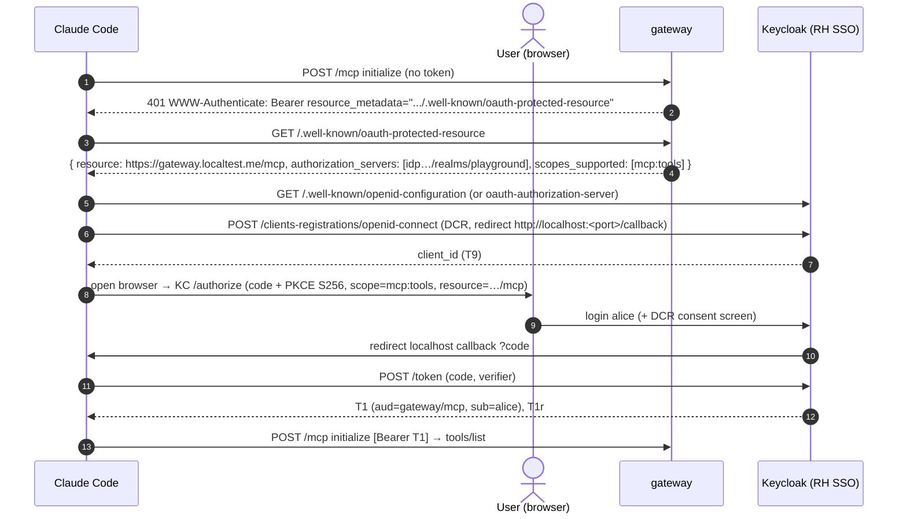
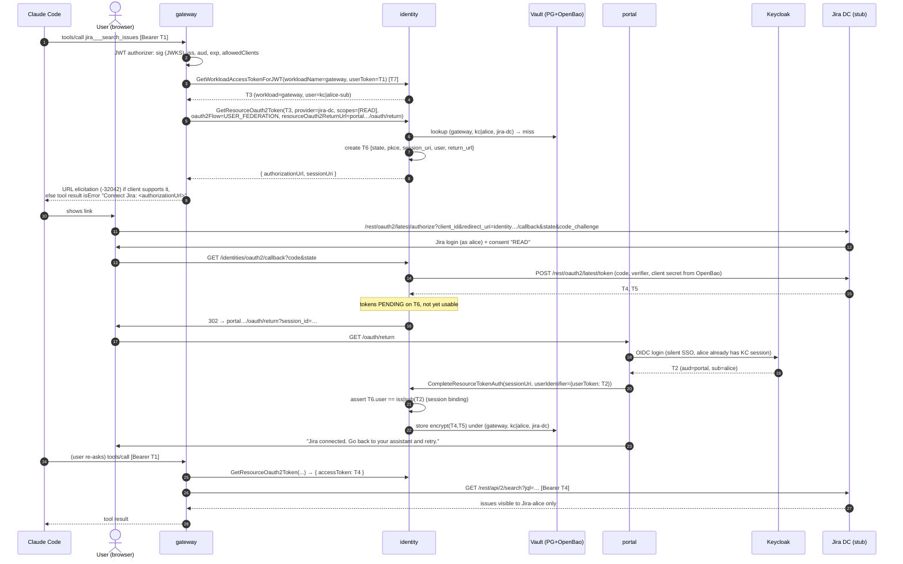

# MCP OAuth Playground — Spec

**Goal:** A local, Docker-based model of this chain:

> **Off-the-shelf MCP client (Claude Code → later GitHub Copilot / MS Copilot) → MCP gateway → Atlassian Data Center**
>
> The user authenticates to the gateway with their corporate identity. The user consents once to the downstream source. The gateway maps the user's identity to the right downstream token, so each user only sees their own Jira/Confluence data.

The production target is **Amazon Bedrock AgentCore Gateway + AgentCore Identity** with **Jira/Confluence Data Center** downstream. This playground copies the AWS component boundaries, API names and token types closely, so what you learn here carries over directly. The aim is to make every token visible: who mints it, who holds it, where it is stored and when it dies.

---

## 0. Decisions log

| # | Decision | Consequence |
|---|---|---|
| D1 | A real Jira/Confluence DC exists but **cannot be connected** to this PoC | The **stub is the only downstream**. Fidelity comes from DC REST/OAuth docs plus optional hand-captured, sanitised sample responses dropped into `fixtures/`. The real-Jira profile is removed. |
| D2 | Production has **two IdPs**: Entra ID (main corporate) and Red Hat SSO. Phase 1 supports **one** | Phase 1 uses **Keycloak configured as Red Hat SSO**. RH SSO is Red Hat's build of Keycloak, so this is near-real rather than a mock. Entra cannot run locally anyway. All code stays issuer-agnostic, and the second IdP is planned for phase 7 (§12). *Flip this if Entra must come first. Only the realm config and §12 change.* |
| D3 | **Off-the-shelf MCP clients** are primary. Claude Code for the PoC; GitHub Copilot (VS Code) next; MS Copilot later | The client runs OAuth itself against the IdP (MCP auth spec), and there is no custom agent app. A small **consent portal** is still needed to finish downstream consent and bind it to the user (§4.2). |

---

## 1. What we are modelling

### 1.1 AWS target → local stand-in

| AWS / production component | Role | Local stand-in | Type |
|---|---|---|---|
| Red Hat SSO (phase 1) / Entra ID (phase 7) | Inbound IdP. Authenticates the human and issues the gateway access token to the MCP client | **Keycloak** (26.x), realm `playground` | Real OSS (RH SSO upstream) |
| MCP client | Discovers auth, runs OAuth + PKCE, holds tokens, calls tools | **Claude Code** (host machine). Later **VS Code + GitHub Copilot** | Real product |
| AgentCore Gateway | MCP server that clients talk to. Has a JWT authorizer inbound, tool aggregation, and injects outbound credentials | **`gateway`** (FastAPI + MCP Python SDK, Streamable HTTP) | Built (mirrors AgentCore config shapes) |
| AgentCore Identity: workload identity + Token Vault | Binds the gateway's workload identity to the user. Stores downstream tokens per (workload, user, provider) | **`identity`** service + **Postgres** | Built (mirrors AgentCore API names) |
| Your consent return URL (`resourceOauth2ReturnUrl`) | Where the user lands after downstream consent. Proves who they are so the session can be bound | **`portal`** (small FastAPI web app; also "Connected apps" + ledger viewer) | Built |
| AWS KMS | Envelope encryption of vaulted tokens | **OpenBao** Transit engine | Real OSS |
| AWS Secrets Manager | Holds the Jira OAuth client_id/secret | **OpenBao** KV v2 | Real OSS |
| IAM (gateway → Identity auth) | Service-to-service auth | Keycloak client-credentials token (`aud=identity`) | Real OSS |
| Jira DC / Confluence DC (OAuth 2.0 provider via *incoming application link*) | Downstream authorization server and resource server | **`atlassian-stub`** | Stub |
| Network inspection | — | **mitmproxy** (mitmweb UI) on all server-to-server traffic | Real OSS |
| TLS edge / DNS | — | **Caddy** (internal CA) with `*.localtest.me` hostnames | Real OSS |

### 1.2 Why build the gateway and Identity rather than use an OSS MCP gateway

OSS MCP gateways exist (agentgateway, IBM ContextForge, Docker MCP Gateway). None of them model AgentCore's **workload identity + token vault + session-bound 3LO consent** split. That split is the thing you need to understand. So the playground builds these two services thinly, using the **same API names and request/response shapes as AgentCore Identity**. When you move to AWS, those call sites map 1:1 to `boto3` `bedrock-agentcore` calls.

---

## 2. Topology

```
   Host machine: Claude Code / VS Code (MCP clients)   +   Browser (OAuth + consent)
                               │  https://*.localtest.me  (→127.0.0.1:443)
                               ▼
                        ┌──────────────┐
                        │    Caddy     │  TLS termination, host routing.
                        │ (internal CA)│  Every container also resolves
                        └──────┬───────┘  *.localtest.me → caddy (network aliases)
     ┌──────────────┬──────────┼─────────────┬──────────────┬───────────────┐
     ▼              ▼          ▼             ▼              ▼               ▼
 idp.localtest.me  portal.…  gateway.…    identity.…     jira.…        confluence.…
   Keycloak        portal    gateway      identity    atlassian-stub  atlassian-stub
                     │          │            │   ├── Postgres (vault, sessions, ledger)
                     │          │            │   └── OpenBao (transit key, KV secrets)
                     └──────────┴────────────┴──── all outbound server-to-server HTTP
                                                    via HTTPS_PROXY=mitmproxy:8080
                                                    → mitmweb UI at localhost:8081
```

**Hostname strategy:** use one URL per service everywhere. This matters because OAuth `iss`, `redirect_uri` and audience checks break when the browser, the MCP client and the containers see different hosts.
- Host: `*.localtest.me` resolves to `127.0.0.1` through public DNS. `make hosts` writes `/etc/hosts` entries as an offline fallback. Caddy listens on host port 443.
- Containers: the Caddy container gets Docker network aliases for every `*.localtest.me` name.
- Trust: `make trust` exports Caddy's root CA to `certs/caddy-root.crt` and installs it in the macOS keychain. Browsers and VS Code then pick it up. **Claude Code is Node and ignores the keychain, so start it with `NODE_EXTRA_CA_CERTS=$PWD/certs/caddy-root.crt`.** `make claude` does this for you. Containers mount a combined bundle (Caddy CA + mitmproxy CA) through `SSL_CERT_FILE` / `REQUESTS_CA_BUNDLE`.

| Host | Service | Internal port |
|---|---|---|
| `idp.localtest.me` | Keycloak (realm `playground`) | 8080 |
| `gateway.localtest.me` | gateway (`/mcp`, `/.well-known/oauth-protected-resource`) | 8000 |
| `identity.localtest.me` | identity (AgentCore-shaped API + `/identities/oauth2/callback`) | 8001 |
| `portal.localtest.me` | portal (consent return URL, connected apps, ledger viewer) | 3000 |
| `jira.localtest.me` | atlassian-stub (Jira persona) | 2990 |
| `confluence.localtest.me` | atlassian-stub (Confluence persona) | 1990 |
| `localhost:8081` | mitmweb | 8081 |
| `localhost:8200` | OpenBao UI/API (dev) | 8200 |

---

## 3. Token inventory

This table is the core of the exercise. Every token in the system appears here, and the build must not create any that aren't listed.

| # | Token | Issuer | Audience / bound to | Holder | Lifetime | Storage |
|---|---|---|---|---|---|---|
| **T1** | Gateway access token | Keycloak (auth code + PKCE, run **by the MCP client**) | `aud=https://gateway.localtest.me/mcp`, scope `mcp:tools`, `azp=<client's DCR client_id>` | MCP client | 5 min | client-local (Claude Code: macOS keychain) |
| **T1r** | Refresh token for T1 | Keycloak | Same client + user | MCP client | 30 min idle | client-local |
| **T2** | Portal session token | Keycloak (portal's own login, usually silent SSO) | `aud=portal` | portal (server-side session) | 5 min | portal session store |
| **T3** | Workload access token | identity | Binds `workload=gateway` + `user=iss|sub` from T1 | gateway (in memory, per tool call) | 5 min | none |
| **T4** | Jira access token | Jira DC (stub) | Jira user who consented, scopes `READ`/`WRITE` | identity token vault **only** | DC default ≈2 h (stub: configurable, 60 s for tests) | Postgres, envelope-encrypted |
| **T5** | Jira refresh token (rotating) | Jira DC (stub) | Same | identity token vault **only** | DC default ≈90 d | Postgres, envelope-encrypted |
| **T6** | 3LO auth session (`state`, PKCE verifier, `session_uri`) | identity | (workload, user, provider, return URL) | identity | 10 min, single use | Postgres |
| **T7** | Gateway service credential | Keycloak client credentials | `aud=identity` | gateway | 5 min | in memory (client secret in OpenBao) |
| **T8** | Jira OAuth client_id/secret ("credential provider") | Jira admin (incoming app link) | — | identity | static | OpenBao KV (≈ Secrets Manager) |
| **T9** | DCR registration (client_id, `registration_access_token`) | Keycloak | MCP client instance | MCP client | until deleted | client-local + Keycloak |

**Invariants. Each one has a test in §8.**
1. T4/T5 never leave the identity service, except that T4 is handed to the gateway for one outbound call. They never reach the MCP client, the LLM or tool results.
2. T1 is never forwarded downstream (MCP spec: no token passthrough). Jira only ever sees T4.
3. The vault lookup key is `(workload_name, user_id, provider_name)`. `user_id` comes **only** from validated T1 claims (`iss` + `sub`), never from tool arguments or headers.
4. A consent session (T6) can only be completed by the same user who started it (session binding, as in `CompleteResourceTokenAuth`).
5. The gateway rejects any token whose `aud` is not its own resource URL (RFC 8707 / MCP auth spec).
6. Logs and the ledger only ever contain token **fingerprints** (`sha256(token)[:12]`) and decoded non-secret claims. Raw tokens never appear.

---

## 4. Flows

### 4.1 Flow A — the MCP client connects (spec-compliant discovery → T1)



### 4.2 Flow B — first tool call, downstream consent required (3LO / USER_FEDERATION)



**Pre-consent path:** a user can also go to `portal.localtest.me/connections` and press "Connect Jira" before using any client. The portal calls `GetResourceOauth2Token` with `GetWorkloadAccessTokenForUserId`. This avoids the mid-chat link entirely and suits off-the-shelf clients with weak elicitation support.

### 4.3 Flow C — subsequent calls and refresh
- Vault hit with T4 still valid → return it.
- T4 expired → identity refreshes with T5 under a **row lock** (`SELECT … FOR UPDATE`). The rotated T5 is stored atomically. Concurrent callers wait and then reuse the new T4.
- Refresh returns `invalid_grant` (revoked, or user deleted in Jira) → purge the vault row and return `authorizationUrl` again, which sends the user back into Flow B.
- Jira returns 401 on a T4 that the vault considers valid → the gateway reports it, identity force-refreshes once, then falls back to re-consent.
- T1 expired → the client uses T1r itself. The gateway just returns 401 with `WWW-Authenticate`.

---

## 5. Identity mapping, the core question

There are three models. The playground implements 1 and 2 and documents 3 as the contrast.

1. **Consent-established mapping (default, the AgentCore model).** The gateway never "looks up" a Jira user. The mapping is created at consent time: whoever logged into Jira during Flow B is the downstream identity, and the token is filed under the IdP user who started *and completed* the session. The vault key is the mapping. Session binding (invariant 4) is what makes this safe.
2. **Verified mapping (optional hardening, `IDENTITY_VERIFY_DOWNSTREAM=true`).** After the token exchange in the callback, identity calls `GET /rest/api/2/myself` and compares the result with the expected Jira username, taken from the Keycloak user attribute `jira_username` (in production, likely a shared AD attribute). On mismatch, the token is discarded and the attempt is logged. This catches the case where alice consents while her browser is logged into Jira as bob. AgentCore does not do this natively. It is the kind of control you would add in an interceptor or Lambda.
3. **Directory-asserted / impersonation (not implemented).** A service account or admin PAT acts "as" the user through a user-context header. Jira DC's OAuth 2.0 provider has no token exchange or JWT-bearer impersonation, so this needs a service account plus app-side authorization. That design moves all access control into your code. It is listed so you can explain why it is rejected.

**Effect of two IdPs on mapping (relevant for phase 7):** the vault key includes `iss`. The same person signing in through Entra and through RH SSO would therefore be **two vault users** and would consent twice. §12 covers how to avoid that.

**Seed identities**

| IdP user | `jira_username` attr | Jira stub user | Jira project access | Confluence space access |
|---|---|---|---|---|
| alice | `alice` | `alice` | ALPHA | ENG |
| bob | `bob` | `bob` | BETA | OPS |
| carol | `carol.w` | `carol.w` (different name, tests the mapping) | ALPHA, BETA (read) | — |
| dave | — | none | — | — (consent should fail cleanly) |

---

## 6. Components

The language is **Python 3.12** with `uv` for every built service. Python matches the `bedrock-agentcore` SDK and the MCP Python SDK. The services are FastAPI, `authlib` / `joserfc` for OAuth/JWT, and `httpx`. A shared package `packages/common` holds JWT validation, ledger emission, fingerprinting and OTel trace propagation.

### 6.1 Keycloak as Red Hat SSO (`infra/keycloak/bootstrap.py`, reconciled on every `make up`)
Pinned to Keycloak **26.8.1**. The realm is configured by an idempotent script through the admin REST API rather than a one-shot realm import, so the config can change without wiping volumes.
- Realm `playground`, users from §5, user attribute `jira_username`. Token lifetimes are short (5 min) so expiry is easy to watch.
- **Client scope `mcp:tools`**: includes an **audience mapper** adding `https://gateway.localtest.me/mcp` to `aud`. It is a **realm *optional* client scope**: DCR-created clients are allowed to request it, but the gateway audience only appears when `scope` includes `mcp:tools`. It is explicitly removed from `portal`, `gateway-svc` and `identity`, so those clients can never mint a gateway-audience token (this is what makes S14 hold).
- **Declarative user profile:** `jira_username` is added to the realm user profile. Keycloak 24+ silently drops unmanaged attributes.
- **DCR for MCP clients:** anonymous registration enabled. Client registration policies:
  - Trusted Hosts allows `localhost`, `127.0.0.1` (Claude Code / VS Code loopback) and `vscode.dev` (VS Code redirect). `client-uris-must-match=true` (redirect URIs must be on those hosts). `host-sending-registration-request-must-match=false`, because registrations arrive through the proxy from the host machine.
  - Allowed Client Scopes includes `mcp:tools`.
  - Consent Required stays on (realistic).
- Pre-registered public client `mcp-public` (PKCE, loopback redirects) as the fallback for clients/IdPs without DCR. **This is the path Entra will force later.**
- `portal`: confidential, standard flow, redirect `https://portal.localtest.me/callback`.
- `gateway-svc`: confidential, client credentials only, audience `identity` (T7).
- `identity`: bearer-only resource.
- **RFC 8707 gap (confirmed in 26.8.1):** the AS metadata does not advertise resource indicators, and the `resource` parameter is accepted but has no effect. Audience comes only from the `mcp:tools` scope mapper. Entra and Cognito differ here too; record them in `docs/aws-mapping.md`.
- **Discovery:** 26.8.1 natively serves the RFC 8414 path-inserted URL that MCP clients try first (`/.well-known/oauth-authorization-server/realms/playground`), but not the path-inserted `openid-configuration` form. No proxy rewrite is needed. **Check the production RH SSO version**: an older build may need a rewrite at its proxy.
- No Client ID Metadata Document (CIMD) support is advertised, so MCP clients will use DCR.

### 6.2 gateway (`services/gateway`)
- **Endpoints:** `POST/GET /mcp` (Streamable HTTP), `GET /.well-known/oauth-protected-resource` (RFC 9728), `GET /healthz`.
- **Unauthenticated requests:** 401 with a `WWW-Authenticate` header carrying `resource_metadata` (and `scope="mcp:tools"`). `insufficient_scope` gets a 403 with the same header.
- **Inbound authorizer:** configured with the same shape as AgentCore `customJWTAuthorizer`. It accepts a **list** of authorizers so that phase 7 is a config change:
  ```yaml
  authorizers:
    - name: rhsso
      discoveryUrl: https://idp.localtest.me/realms/playground/.well-known/openid-configuration
      allowedAudience: ["https://gateway.localtest.me/mcp"]
      allowedClients: ["*"]          # DCR clients; tighten via allowlist pattern
  ```
- **Targets:** config file, with names following AgentCore's `target___tool` convention:
  ```yaml
  targets:
    - name: jira
      type: openapi            # mirrors AgentCore OpenAPI target
      baseUrl: https://jira.localtest.me
      spec: specs/jira-dc-subset.yaml
      credentialProvider: { name: jira-dc, type: oauth2, flow: USER_FEDERATION, scopes: [READ] }
    - name: confluence
      type: openapi
      baseUrl: https://confluence.localtest.me
      spec: specs/confluence-dc-subset.yaml
      credentialProvider: { name: confluence-dc, type: oauth2, flow: USER_FEDERATION, scopes: [READ] }
  ```
- **Tools (v1):** `jira___get_myself`, `jira___search_issues(jql, maxResults)`, `jira___get_issue(key)`, `jira___add_comment(key, body)` (needs `WRITE` and exercises step-up), `confluence___search(cql)`, `confluence___get_page(id)`. Plus `gateway___whoami`, which needs no downstream and returns the decoded inbound claims, useful for phase 3.
- **Consent signalling:** if the client declared URL-mode elicitation in `initialize` capabilities, the gateway raises `-32042 URLElicitationRequiredError` (spec 2025-11-25). Otherwise it returns a tool result with `isError: true`, a short human message and the link. **The fallback is the expected path for today's off-the-shelf clients.** Phase 4 records what Claude Code and VS Code actually do.
- **Must not:** cache T4 beyond a single call, log T4, or accept tool args that influence user identity.

### 6.3 identity (`services/identity`)
The API names and fields mirror AgentCore Identity. The transport is JSON over HTTPS, authenticated with T7 (gateway) or the portal's client credentials.

| Endpoint | Purpose |
|---|---|
| `POST /identities/CreateWorkloadIdentity` | Register `gateway` (plus allowed return URLs: `portal.localtest.me/oauth/return`) |
| `POST /identities/CreateOauth2CredentialProvider` | Register `jira-dc` / `confluence-dc`: explicit `authorizationServerMetadata` (issuer, authorizationEndpoint, tokenEndpoint), since **Jira DC has no `.well-known` discovery**. Client secret goes to OpenBao KV. |
| `POST /identities/GetWorkloadAccessTokenForJWT` | Validate the user JWT (T1) and mint T3 |
| `POST /identities/GetWorkloadAccessTokenForUserId` | Same, with an explicit userId (portal pre-consent; mirrors the AWS API) |
| `POST /identities/GetResourceOauth2Token` | Vault lookup/refresh, or start 3LO and return `{authorizationUrl, sessionUri}`. Supports `forceAuthentication` and scope step-up. |
| `GET  /identities/oauth2/callback` | Downstream redirect target. Exchanges the code and parks the tokens as PENDING on the session. |
| `POST /identities/CompleteResourceTokenAuth` | Session binding: checks the user in `userIdentifier.userToken` (T2) matches the session user, then commits to the vault |
| `GET/DELETE /admin/vault` | Debug: list entries (metadata + fingerprints only) and revoke |

For identity, "same user" means the same `iss|sub`. T1 and T2 have different audiences but the same issuer and subject, so identity validates `userToken` against an allowlist of audiences (`gateway/mcp`, `portal`).

**Vault schema (Postgres):**
```sql
create table token_vault (
  workload_name   text not null,
  user_id         text not null,          -- iss|sub
  provider_name   text not null,
  scopes          text[] not null,
  downstream_user text,                   -- from /myself, if verified
  access_ct       bytea not null,         -- AES-256-GCM ciphertext
  refresh_ct      bytea,
  wrapped_dek     text not null,          -- OpenBao transit-wrapped data key (≈ KMS GenerateDataKey)
  access_expires_at  timestamptz not null,
  refresh_rotated_at timestamptz,
  created_at timestamptz default now(),
  primary key (workload_name, user_id, provider_name)
);
create table oauth_sessions (...);  -- T6: state, pkce_verifier_ct, user_id, return_url, status, expires_at
create table token_ledger (...);    -- §7
```

### 6.4 portal (`services/portal`)
- `/oauth/return`: OIDC login (silent if a Keycloak session exists), then `CompleteResourceTokenAuth`, then a "Connected, return to your assistant" page.
- `/connections`: lists the current user's vault entries (metadata from identity), with Connect / Disconnect per provider (pre-consent path).
- `/ledger`: ledger viewer (§7).
- This is the one piece you will **also need in AWS**. AgentCore requires you to host the return URL.

### 6.5 atlassian-stub (`services/atlassian-stub`)
One codebase that runs in two personas (Jira on :2990, Confluence on :1990). It is the only downstream (D1), so it has to match the DC behaviour that affects auth:
- **OAuth 2.0 provider (incoming application link):** `GET /rest/oauth2/latest/authorize`, `POST /rest/oauth2/latest/token`. Supports auth code with PKCE (S256), `refresh_token` grant with **rotation**, and `client_secret_post`. Scopes `READ`, `WRITE`, `ADMIN`, `SYSTEM_ADMIN`. Opaque tokens. **No** discovery document, introspection or token exchange.
- Login page and session cookie. The consent page shows the app name and requested scopes. A user page "Authorized applications" can revoke grants. An admin page registers incoming links (client id/secret, redirect URL), seeded at boot.
- **REST subset, response shapes copied from DC REST v2:** `/rest/api/2/myself`, `/rest/api/2/search`, `/rest/api/2/issue/{key}`, `/rest/api/2/issue/{key}/comment`; Confluence `/rest/api/content/search`, `/rest/api/content/{id}`. Results are filtered by the token owner's project/space permissions.
- **Personal Access Tokens** (`Authorization: Bearer <PAT>`) for contrast tests. On DC, both PATs and OAuth tokens use Bearer.
- **Fault injection, set by env or admin endpoint:** access TTL, refresh TTL, revoke-all, forced 401, forced `invalid_grant`, latency.
- **Fidelity checklist (`docs/stub-fidelity.md`):** behaviours to confirm by hand on the real instance and record, since it can't be connected (§11 R4). Also the version number. Sanitised JSON samples captured manually can be dropped into `fixtures/` and the stub will serve their shapes.

### 6.6 Infra
- **Postgres 16**: databases `identity`, `keycloak`, `portal`.
- **OpenBao** (2.7.1, **server mode, not dev**): single-node Raft storage (2.x has removed `file`), so the transit key survives restarts. `infra/openbao/bootstrap.py` runs on every `up`. On first run it initialises with one unseal key and saves that key and the root token to `.secrets/openbao-init.json` (gitignored). On every run it unseals, waits for the node to become Raft-active, and makes sure transit key `vault-dek` and KV v2 `secret/` exist. Unsealing is a local-only concern, since AWS KMS has no equivalent. Paths `secret/credential-providers/*` and `secret/clients/*` are created by later phases.
- **mitmproxy** (`mitmweb`): all built services set `HTTPS_PROXY`. Traffic from the MCP client and the browser is not proxied. Use `make claude-mitm` to run Claude Code through mitmproxy too (`HTTPS_PROXY` + `NODE_EXTRA_CA_CERTS` bundle) when you want to see Flow A on the wire.
- **Caddy**: TLS edge plus network aliases.

### 6.7 Client setup (`docs/clients.md`)
- **Claude Code:** `make claude` (sets `NODE_EXTRA_CA_CERTS`), then `claude mcp add --transport http atlassian https://gateway.localtest.me/mcp`, then `/mcp` → Authenticate.
- **VS Code + GitHub Copilot (phase 6):** `.vscode/mcp.json` with `{"servers":{"atlassian":{"type":"http","url":"https://gateway.localtest.me/mcp"}}}`. Uses the DCR path, or prompts for a client id → `mcp-public`.
- **MS Copilot (Copilot Studio): out of scope for the local PoC.** It runs in Microsoft's cloud and cannot reach `localtest.me`. It needs a public endpoint (phase 8, AWS).

---

## 7. Observability: watching the tokens move

1. **Token ledger.** Every built service emits a ledger event on every token receipt, validation, mint, store, refresh, use and revoke:
   ```json
   {"ts":"…","trace_id":"…","service":"identity","event":"vault.store",
    "token":"T4","fp":"3f9a1c0b7e21","iss":"jira.localtest.me","sub":"alice",
    "aud":null,"scope":["READ"],"exp":"…","user_id":"kc|8d2…","workload":"gateway"}
   ```
   Events go into the `token_ledger` table. The portal **Ledger viewer** renders one flow as a timeline and as an auto-generated Mermaid sequence diagram. Off-the-shelf clients won't send `traceparent`, so the gateway starts the trace. The consent session id links Flow B's browser leg back to it.
2. **mitmweb** shows the raw HTTP of each hop. A mitmproxy addon decodes JWTs inline and labels them T1–T9 by matching fingerprints against the ledger.
3. **Keycloak admin console** → Sessions / Clients shows DCR-registered clients and live sessions, so you can watch what Claude Code registered.
4. **`make vault-dump`** prints the vault rows (metadata, wrapped DEK, ciphertext length) so you can see what an attacker with database access would get.

---

## 8. Acceptance scenarios

Automated in `tests/e2e`: pytest + a scripted MCP client (Python SDK, doing Flow A like Claude Code) + Playwright for browser legs. Rows marked **(manual)** are run in a real client and the results written into `docs/clients.md`.

| # | Scenario | Expected |
|---|---|---|
| S1 | Unauthenticated `initialize` | 401 + `resource_metadata`. PRM correct. DCR + PKCE yields T1 with correct `aud` |
| S2 | **(manual)** Claude Code connects (Flow A) | Browser login. `/mcp` shows connected. `gateway___whoami` returns alice's claims |
| S3 | alice's first `jira___search_issues` | Consent link (elicitation or isError fallback) → consent → portal binds → retry returns **ALPHA only** |
| S4 | **(manual)** S3 in Claude Code | Record exactly how the link is rendered and what the user experience is |
| S5 | alice repeats the call | No consent. Vault hit. Jira sees only T4 |
| S6 | T4 expires (stub TTL 60 s) | Transparent refresh. T5 rotated and stored. Old T5 rejected by stub |
| S7 | 10 parallel calls at expiry | Exactly **one** refresh. No `invalid_grant` |
| S8 | bob uses the same gateway | Separate consent. **BETA only**. alice's row untouched |
| S9 | **Consent hijack:** alice's `authorizationUrl` is completed in bob's browser (portal login = bob) | `CompleteResourceTokenAuth` fails (user mismatch). Nothing stored for either user |
| S10 | alice consents while logged into Jira as bob (verify mode on) | Rejected at callback (`/myself`=bob ≠ alice). Ledger records the mismatch |
| S11 | carol (`carol.w`) | Mapping via attribute works. Sees ALPHA+BETA |
| S12 | dave (no Jira account) | Consent fails cleanly. Tool returns a clear error. No vault row |
| S13 | User revokes the app in Jira | Next call: 401 → refresh `invalid_grant` → row purged → consent link again |
| S14 | Token with wrong audience (e.g. T2 portal token) sent to gateway | 401 + `WWW-Authenticate` |
| S15 | T1 sent straight to Jira | 401 (proves no passthrough path) |
| S16 | `jira___add_comment` with READ-only grant | Step-up: new consent for `WRITE`. Vault scopes updated |
| S17 | alice disabled in Keycloak | Client refresh fails. **An already-issued T1 still works until `exp`** (documents the gap; optional `GATEWAY_INTROSPECT=true` closes it) |
| S18 | Pre-consent via portal `/connections`, then first tool call | No consent link. Vault hit |
| S19 | Grep all logs and the ledger for raw token values | Zero hits (invariant 6) |
| S20 | **(manual, phase 6)** VS Code + Copilot | Flow A via DCR or `mcp-public`. S3 works. UX recorded |

---

## 9. Repository layout

```
mcp-server-playground/
├── SPEC.md
├── docker-compose.yml
├── Makefile                    # up, down, trust, hosts, seed, claude, claude-mitm, vault-dump, test
├── .env.example
├── certs/                      # exported Caddy root CA + mitmproxy CA (gitignored)
├── .secrets/                   # OpenBao unseal key + root token (gitignored)
├── scripts/                    # phase exit-criteria checks (phase0_check.py, …)
├── infra/
│   ├── caddy/Caddyfile
│   ├── keycloak/bootstrap.py     # idempotent realm reconcile
│   ├── openbao/{config.hcl,bootstrap.py}
│   ├── postgres/init.sh
│   └── mitmproxy/addons/token_labeler.py
├── packages/common/            # jwt validate, ledger, fingerprint, otel
├── services/
│   ├── gateway/                # config/gateway.yaml, specs/*.yaml
│   ├── identity/
│   ├── portal/
│   └── atlassian-stub/         # seed/*.json, fixtures/
├── tests/e2e/
└── docs/
    ├── flows/                  # mermaid sources for §4
    ├── clients.md              # per-client setup + observed behaviour
    ├── stub-fidelity.md        # things to confirm on the real DC instance
    └── aws-mapping.md
```

---

## 10. Build phases

| Phase | Deliverable | Exit criteria |
|---|---|---|
| **0. Edge & IdP** | Caddy, TLS trust, Keycloak realm (RH SSO config, DCR policies), Postgres, OpenBao, mitmweb | Browser login to `idp.localtest.me` over trusted TLS. A DCR registration via curl works |
| **1. Gateway shell** | MCP server, PRM, JWT authorizer, `gateway___whoami` only | S1, S2, S14: **Claude Code connects and shows your claims** (first real milestone) |
| **2. Stub downstream** | atlassian-stub (Jira persona): OAuth provider + REST subset + seed | Manual auth-code + PKCE via curl/browser returns T4. `/search` filtered per user |
| **3. Identity + vault** | identity service, envelope encryption, sessions, callback, CompleteResourceTokenAuth | Scripted Flow B without gateway. S9 passes |
| **4. End-to-end 3LO** | Gateway targets + consent signalling + portal + ledger viewer + mitmproxy labeler | S3, S4, S5, S8, S15, S18: **Claude Code fetches alice's Jira issues after consent** |
| **5. Lifecycle & attacks** | Refresh locking, revocation, step-up, verify mode, fault injection | S6, S7, S10–S13, S16, S17, S19 |
| **6. More clients & sources** | VS Code + Copilot; Confluence persona | S20, Confluence tools |
| **7. Second IdP** | Decide and implement Entra alongside RH SSO (§12) | Design record + one of the §12 options working |
| **8. AWS port (separate spec)** | Gateway/identity replaced by AgentCore. Portal deployed. Public endpoint for clients | §11 checklist answered |

---

## 11. Mapping to AWS, and risks to verify early

**Call-site mapping (identity service → AgentCore):** `GetWorkloadAccessTokenForJWT`, `GetWorkloadAccessTokenForUserId`, `GetResourceOauth2Token` (`oauth2Flow=USER_FEDERATION`), `CompleteResourceTokenAuth` and `CreateOauth2CredentialProvider` (custom provider, explicit `authorizationServerMetadata`) are the same operation names in `bedrock-agentcore` / `bedrock-agentcore-control`. The gateway `authorizers` block maps to `customJWTAuthorizer`, and `targets[].credentialProvider` maps to the target's outbound credential provider configuration.

**Risks / things to check against current AWS and Atlassian docs:**
- **R1. Network reachability (likely the biggest real-world issue).** In 3LO, the **token endpoint is called by AgentCore Identity from AWS-managed infrastructure**, and the API calls go from the Gateway. If Jira DC is on-prem or in a private network, check what private connectivity AgentCore Gateway targets and Identity credential providers support today. You may need an allowlisted public token endpoint, or a Lambda/VPC target pattern.
- **R2. Gateway 3LO surface.** Check how AgentCore Gateway currently returns the authorization URL to the MCP client, and whether 3LO outbound is supported for the target type you want (OpenAPI vs. MCP-server target). Compare that with what Claude Code and Copilot render (S4/S20).
- **R3. Gateway inbound + off-the-shelf clients.** Check whether AgentCore Gateway serves PRM / `WWW-Authenticate` discovery itself. Also check how many JWT authorizers / issuers one gateway accepts, which matters for two IdPs.
- **R4. Jira DC OAuth specifics. Confirm on the real instance by hand (D1):** product version; PKCE support; access/refresh token TTLs and rotation; whether the incoming link accepts the AgentCore callback URL (`https://bedrock-agentcore.<region>.amazonaws.com/identities/oauth2/callback`) as its redirect URI; separate consent for Jira and Confluence. Record the results in `docs/stub-fidelity.md` and tune the stub.
- **R5. Entra + off-the-shelf clients.** Entra has no DCR, so clients need a pre-registered app or a client-specific integration. Entra v2 access tokens for a custom API carry `aud` = the app ID URI or GUID, not the MCP resource URL. Check how Copilot and Claude handle this against an Entra-protected MCP server.
- **R6. Identity alignment.** Check whether RH SSO, Entra and Jira DC users come from the same AD. This decides whether verify mode (§5.2) can use a shared attribute (e.g. `sAMAccountName`).

---

## 12. Second IdP (phase 7, design options; decide later)

| Option | How | Pros | Cons |
|---|---|---|---|
| **A. RH SSO brokers Entra** | Keycloak identity brokering: Entra is an upstream IdP of the RH SSO realm. The gateway trusts **one** issuer | One issuer, one `sub` per person → one vault entry. DCR still works. Probably how RH SSO already relates to Entra (check) | Extra hop. Clients that natively speak Entra (MS Copilot) may not want to go through RH SSO |
| **B. Gateway trusts both issuers** | Two entries in `authorizers` | Each client uses its native IdP | Same human = two `iss|sub` → **two consents, two vault rows**, unless identity normalises `user_id` through a shared claim (e.g. UPN/email or AD objectId) — which is itself a mapping risk |
| **C. One gateway per IdP** | Separate gateway + workload identity per IdP | Simple and isolated | Duplicate consents. Twice the operational overhead |

Locally, Entra can be imitated with a second Keycloak realm `entra-sim` that emits Entra-shaped claims (`oid`, `tid`, `upn`, v2 `aud`, no DCR). A free Entra developer tenant can be used if you have one.

## 13. Out of scope (v1)
HA/production hardening. Real KMS/Secrets Manager (covered in phase 8). Jira Cloud (a different OAuth model). Writing to Confluence. Multi-tenant gateway. MS Copilot / Copilot Studio (needs a public endpoint). Connecting to the real Jira instance (D1).

## 14. Changelog
Design changes discovered during the build. The detail behind each change lives in the PROGRESS.md discoveries log.

| Date | Section | Change |
|---|---|---|
| 2026-11-19 | all | Initial spec. Revised for decisions D1–D3 (stub-only downstream, RH SSO first, off-the-shelf clients) |
| 2026-11-19 | §6.1, §6.6, §9 | Phase 0: Keycloak configured by an idempotent bootstrap script instead of a realm import. `mcp:tools` is a realm *optional* scope (was: default) so non-MCP clients can't get the gateway audience. RFC 8707 and discovery behaviour of 26.8.1 recorded. OpenBao runs in server mode with Raft (was: dev mode) |
