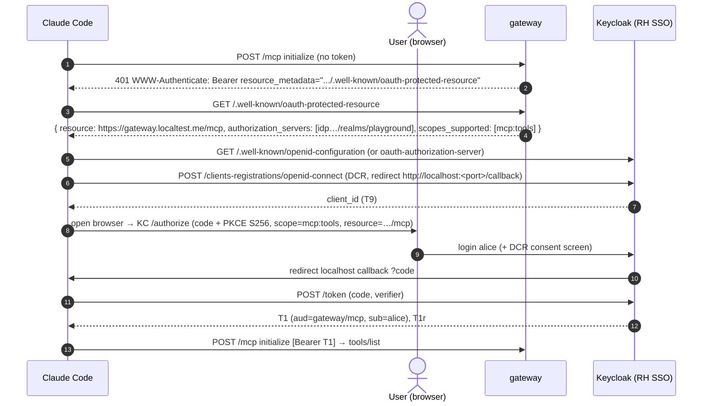
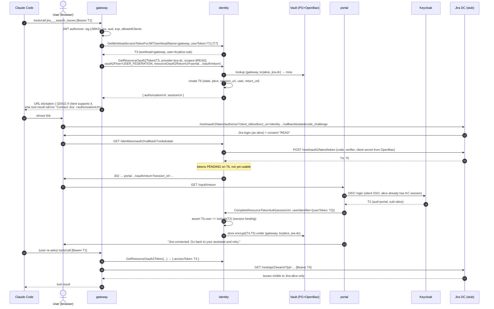

# MCP OAuth Playground — Spec

**Goal:** A local, Docker-based model of this chain:

> **Off-the-shelf MCP client (Claude Code → later GitHub Copilot / MS Copilot) → MCP gateway → Atlassian Data Center**
>
> The user authenticates to the gateway with their corporate identity. The user consents once to the downstream source. The gateway maps the user's identity to the right downstream token, so each user only sees their own Jira/Confluence data.

The production target is **Amazon Bedrock AgentCore Gateway + AgentCore Identity** with **Jira/Confluence Data Center** downstream. This playground copies the AWS component boundaries, API names and token types closely, so what you learn here carries over directly. The aim is to make every token visible: who mints it, who holds it, where it is stored and when it dies.

---

## 0. Decisions log

| # | Decision | Consequence |
|---|---|---|
| D1 | A real Jira/Confluence DC exists but **cannot be connected** to this PoC | The **stub is the only downstream**. Fidelity comes from DC REST/OAuth docs plus optional hand-captured, sanitised sample responses dropped into `fixtures/`. The real-Jira profile is removed. |
| D2 | Production has **two IdPs**: Entra ID (main corporate) and Red Hat SSO. Phase 1 supports **one** | Phase 1 uses **Keycloak configured as Red Hat SSO**. RH SSO is Red Hat's build of Keycloak, so this is near-real rather than a mock. Entra cannot run locally anyway. All code stays issuer-agnostic, and the second IdP is planned for phase 7 (§12). *Flip this if Entra must come first. Only the realm config and §12 change.* |
| D3 | **Off-the-shelf MCP clients** are primary. Claude Code for the PoC; GitHub Copilot (VS Code) next; MS Copilot later | The client runs OAuth itself against the IdP (MCP auth spec), and there is no custom agent app. A small **consent portal** is still needed to finish downstream consent and bind it to the user (§4.2). |

---

> The architecture view (components, login/consent moments, step-by-step token flows with verification status) is in [docs/architecture.md](docs/architecture.md).

## 1. What we are modelling

### 1.1 AWS target → local stand-in

| AWS / production component | Role | Local stand-in | Type |
|---|---|---|---|
| Red Hat SSO (phase 1) / Entra ID (phase 7) | Inbound IdP. Authenticates the human and issues the gateway access token to the MCP client | **Keycloak** (26.x), realm `playground` | Real OSS (RH SSO upstream) |
| MCP client | Discovers auth, runs OAuth + PKCE, holds tokens, calls tools | **Claude Code** (host machine). Later **VS Code + GitHub Copilot** | Real product |
| AgentCore Gateway | MCP server that clients talk to. Has a JWT authorizer inbound, tool aggregation, and injects outbound credentials | **`gateway`** (FastAPI + MCP Python SDK, Streamable HTTP) | Built (mirrors AgentCore config shapes) |
| AgentCore Identity: workload identity + Token Vault | Binds the gateway's workload identity to the user. Stores downstream tokens per (workload, user, provider) | **`identity`** service + **Postgres** | Built (mirrors AgentCore API names) |
| Your consent return URL (`resourceOauth2ReturnUrl`) | Where the user lands after downstream consent. Proves who they are so the session can be bound | **`portal`** (small FastAPI web app; also "Connected apps" + ledger viewer) | Built |
| AWS KMS | Envelope encryption of vaulted tokens | **OpenBao** Transit engine | Real OSS |
| AWS Secrets Manager | Holds the Jira OAuth client_id/secret | **OpenBao** KV v2 | Real OSS |
| IAM (gateway → Identity auth) | Service-to-service auth | Keycloak client-credentials token (`aud=identity`) | Real OSS |
| Jira DC / Confluence DC (OAuth 2.0 provider via *incoming application link*) | Downstream authorization server and resource server | **`atlassian-stub`** | Stub |
| Network inspection | — | **mitmproxy** (mitmweb UI) on all server-to-server traffic | Real OSS |
| TLS edge / DNS | — | **Caddy** (internal CA) with `*.localtest.me` hostnames | Real OSS |

### 1.2 Why build the gateway and Identity rather than use an OSS MCP gateway

OSS MCP gateways exist (agentgateway, IBM ContextForge, Docker MCP Gateway). None of them model AgentCore's **workload identity + token vault + session-bound 3LO consent** split. That split is the thing you need to understand. So the playground builds these two services thinly, using the **same API names and request/response shapes as AgentCore Identity**. When you move to AWS, those call sites map 1:1 to `boto3` `bedrock-agentcore` calls.

---

## 2. Topology

```
   Host machine: Claude Code / VS Code (MCP clients)   +   Browser (OAuth + consent)
                               │  https://*.localtest.me  (→127.0.0.1:443)
                               ▼
                        ┌──────────────┐
                        │    Caddy     │  TLS termination, host routing.
                        │ (internal CA)│  Every container also resolves
                        └──────┬───────┘  *.localtest.me → caddy (network aliases)
     ┌──────────────┬──────────┼─────────────┬──────────────┬───────────────┐
     ▼              ▼          ▼             ▼              ▼               ▼
 idp.localtest.me  portal.…  gateway.…    identity.…     jira.…        confluence.…
   Keycloak        portal    gateway      identity    atlassian-stub  atlassian-stub
                     │          │            │   ├── Postgres (vault, sessions, ledger)
                     │          │            │   └── OpenBao (transit key, KV secrets)
                     └──────────┴────────────┴──── all outbound server-to-server HTTP
                                                    via HTTPS_PROXY=mitmproxy:8080
                                                    → mitmweb UI at localhost:8081
```

**Hostname strategy:** use one URL per service everywhere. This matters because OAuth `iss`, `redirect_uri` and audience checks break when the browser, the MCP client and the containers see different hosts.
- Host: `*.localtest.me` resolves to `127.0.0.1` through public DNS. `make hosts` writes `/etc/hosts` entries as an offline fallback. Caddy listens on host port 443.
- Containers: the Caddy container gets Docker network aliases for every `*.localtest.me` name.
- Trust: `make trust` exports Caddy's root CA to `certs/caddy-root.crt` and installs it in the macOS keychain. Browsers and VS Code then pick it up. **Claude Code is Node and ignores the keychain, so start it with `NODE_EXTRA_CA_CERTS=$PWD/certs/caddy-root.crt`.** `make claude` does this for you. Containers mount a combined bundle (Caddy CA + mitmproxy CA) through `SSL_CERT_FILE` / `REQUESTS_CA_BUNDLE`.

| Host | Service | Internal port |
|---|---|---|
| `idp.localtest.me` | Keycloak (realm `playground`) | 8080 |
| `gateway.localtest.me` | gateway (`/mcp`, `/.well-known/oauth-protected-resource`) | 8000 |
| `identity.localtest.me` | identity (AgentCore-shaped API + `/identities/oauth2/callback`) | 8001 |
| `portal.localtest.me` | portal (consent return URL, connected apps, ledger viewer) | 3000 |
| `jira.localtest.me` | atlassian-stub (Jira persona) | 2990 |
| `confluence.localtest.me` | atlassian-stub (Confluence persona) | 1990 |
| `localhost:8081` | mitmweb | 8081 |
| `localhost:8200` | OpenBao UI/API (dev) | 8200 |

---

## 3. Token inventory

This table is the core of the exercise. Every token in the system appears here, and the build must not create any that aren't listed.

| # | Token | Issuer | Audience / bound to | Holder | Lifetime | Storage |
|---|---|---|---|---|---|---|
| **T1** | Gateway access token | Keycloak (auth code + PKCE, run **by the MCP client**) | `aud=https://gateway.localtest.me/mcp`, scope `mcp:tools`, `azp=<client's DCR client_id>` | MCP client | 5 min | client-local (Claude Code: macOS keychain) |
| **T1r** | Refresh token for T1 | Keycloak | Same client + user | MCP client | 30 min idle | client-local |
| **T2** | Portal user token | Keycloak (portal's own login, silent with SSO) | `aud=portal` | portal, for **one request** (the binding call) | 5 min | **none**: never stored. The portal cookie holds only user id + name |
| **T3** | Workload access token | identity | Binds `workload=gateway` + `user=iss|sub` from T1 | gateway (in memory, per tool call) | 5 min | none |
| **T4** | Jira access token | Jira DC (stub) | Jira user who consented, scopes `READ`/`WRITE` | identity token vault **only** | DC default ≈2 h (stub: configurable, 60 s for tests) | Postgres, envelope-encrypted |
| **T5** | Jira refresh token (rotating) | Jira DC (stub) | Same | identity token vault **only** | DC default ≈90 d | Postgres, envelope-encrypted |
| **T6** | 3LO auth session (`state`, PKCE verifier, `session_uri`) | identity | (workload, user, provider, return URL) | identity | 10 min, single use | Postgres |
| **T7** | Gateway service credential (and the portal's equivalent from `portal-svc`) | Keycloak client credentials | `aud=identity` | gateway / portal | 5 min | in memory (client secret in `.env` today) |
| **T8** | Jira OAuth client_id/secret ("credential provider") | Jira admin (incoming app link) | — | identity | static | OpenBao KV (≈ Secrets Manager) |
| **T9** | DCR registration (client_id, `registration_access_token`) | Keycloak | MCP client instance | MCP client | until deleted | client-local + Keycloak |

**Invariants. Each one has a test in §8.**
1. T4/T5 never leave the identity service, except that T4 is handed to the gateway for one outbound call. They never reach the MCP client, the LLM or tool results.
2. T1 is never forwarded downstream (MCP spec: no token passthrough). Jira only ever sees T4.
3. The vault lookup key is `(workload_name, user_id, provider_name)`. `user_id` comes **only** from validated T1 claims (`iss` + `sub`), never from tool arguments or headers.
4. A consent session (T6) can only be completed by the same user who started it (session binding, as in `CompleteResourceTokenAuth`).
5. The gateway rejects any token whose `aud` is not its own resource URL (RFC 8707 / MCP auth spec).
6. Logs and the ledger only ever contain token **fingerprints** (`sha256(token)[:12]`) and decoded non-secret claims. Raw tokens never appear.

---

## 4. Flows

### 4.1 Flow A — the MCP client connects (spec-compliant discovery → T1)



### 4.2 Flow B — first tool call, downstream consent required (3LO / USER_FEDERATION)



**Pre-consent path:** a user can also go to `portal.localtest.me/connections` and press "Connect Jira" before using any client. The portal calls `GetResourceOauth2Token` with `GetWorkloadAccessTokenForUserId`. This avoids the mid-chat link entirely and suits off-the-shelf clients with weak elicitation support.

### 4.3 Flow C — subsequent calls and refresh
- Vault hit with T4 still valid → return it.
- T4 expired → identity refreshes with T5 under a **row lock** (`SELECT … FOR UPDATE`). The rotated T5 is stored atomically. Concurrent callers wait and then reuse the new T4.
- Refresh returns `invalid_grant` (revoked, or user deleted in Jira) → purge the vault row and return `authorizationUrl` again, which sends the user back into Flow B.
- Jira returns 401 on a T4 that the vault considers valid → the gateway reports it, identity force-refreshes once, then falls back to re-consent.
- T1 expired → the client uses T1r itself. The gateway just returns 401 with `WWW-Authenticate`.

---

## 5. Identity mapping, the core question

There are three models. The playground implements 1 and 2 and documents 3 as the contrast.

1. **Consent-established mapping (default, the AgentCore model).** The gateway never "looks up" a Jira user. The mapping is created at consent time: whoever logged into Jira during Flow B is the downstream identity, and the token is filed under the IdP user who started *and completed* the session. The vault key is the mapping. Session binding (invariant 4) is what makes this safe.
2. **Verified mapping (optional hardening, `IDENTITY_VERIFY_DOWNSTREAM=true`).** After the token exchange in the callback, identity calls `GET /rest/api/2/myself` and compares the result with the expected Jira username, taken from the Keycloak user attribute `jira_username` (in production, likely a shared AD attribute). On mismatch, the token is discarded and the attempt is logged. This catches the case where alice consents while her browser is logged into Jira as bob. AgentCore does not do this natively. It is the kind of control you would add in an interceptor or Lambda.
3. **Directory-asserted / impersonation (not implemented).** A service account or admin PAT acts "as" the user through a user-context header. Jira DC's OAuth 2.0 provider has no token exchange or JWT-bearer impersonation, so this needs a service account plus app-side authorization. That design moves all access control into your code. It is listed so you can explain why it is rejected.

**Effect of two IdPs on mapping (relevant for phase 7):** the vault key includes `iss`. The same person signing in through Entra and through RH SSO would therefore be **two vault users** and would consent twice. §12 covers how to avoid that.

**Seed identities**

| IdP user | `jira_username` attr | Jira stub user | Jira project access | Confluence space access |
|---|---|---|---|---|
| alice | `alice` | `alice` | ALPHA | ENG |
| bob | `bob` | `bob` | BETA | OPS |
| carol | `carol.w` | `carol.w` (different name, tests the mapping) | ALPHA, BETA (read) | — |
| dave | — | none | — | — (consent should fail cleanly) |

---

## 6. Components

The language is **Python 3.12**. The repo is a `uv` workspace (`pyproject.toml` at the root, `uv.lock`), with members `packages/*` and `services/*`. Python matches the `bedrock-agentcore` SDK and the MCP Python SDK. Libraries: **MCP Python SDK 2.x** (`mcp.server.mcpserver.MCPServer`, formerly FastMCP), Starlette (which comes with the SDK), PyJWT for JWT validation, and **`httpx2`** (the fork the MCP SDK 2.x depends on) for outbound HTTP. A shared package `packages/common` (`playground_common`) holds the multi-issuer JWT authorizer, ledger emission, fingerprinting and the outbound HTTP client. The client trusts only the CA files listed in `CA_FILES` and sends traffic through `HTTPS_PROXY`.

### 6.1 Keycloak as Red Hat SSO (`infra/keycloak/bootstrap.py`, reconciled on every `make up`)
Pinned to Keycloak **26.8.1**. The realm is configured by an idempotent script through the admin REST API rather than a one-shot realm import, so the config can change without wiping volumes.
- Realm `playground`, users from §5, user attribute `jira_username`. Token lifetimes are short (5 min) so expiry is easy to watch.
- **Client scope `mcp:tools`**: includes an **audience mapper** adding `https://gateway.localtest.me/mcp` to `aud`. It is a **realm *optional* client scope**: DCR-created clients are allowed to request it, but the gateway audience only appears when `scope` includes `mcp:tools`. It is explicitly removed from `portal`, `gateway-svc` and `identity`, so those clients can never mint a gateway-audience token (this is what makes S14 hold).
- **Declarative user profile:** `jira_username` is added to the realm user profile. Keycloak 24+ silently drops unmanaged attributes.
- **DCR for MCP clients:** anonymous registration enabled. Client registration policies:
  - Trusted Hosts allows `localhost`, `127.0.0.1` (Claude Code / VS Code loopback) and `vscode.dev` (VS Code redirect). `client-uris-must-match=true` (redirect URIs must be on those hosts). `host-sending-registration-request-must-match=false`, because registrations arrive through the proxy from the host machine.
  - Allowed Client Scopes includes `mcp:tools`.
  - Consent Required stays on (realistic).
- Pre-registered public client `mcp-public` (PKCE, loopback redirects) as the fallback for clients/IdPs without DCR. **This is the path Entra will force later.**
- `portal`: confidential, standard flow, redirect `https://portal.localtest.me/callback`. An audience mapper sets **`aud=portal`** on user tokens (T2).
- `portal-svc`: confidential, client credentials only, audience `identity`. This is the portal's **service** credential for identity, kept separate so that a user's T2 can never act as the portal service.
- `gateway-svc`: confidential, client credentials only, audience `identity` (T7).
- Keycloak also adds `account` to `aud` on these tokens (default roles). That's harmless because every check names its own audience.
- `identity`: bearer-only resource.
- **RFC 8707 gap (confirmed in 26.8.1):** the AS metadata does not advertise resource indicators, and the `resource` parameter is accepted but has no effect. Audience comes only from the `mcp:tools` scope mapper. Entra and Cognito differ here too; record them in `docs/aws-mapping.md`.
- **Discovery:** 26.8.1 natively serves the RFC 8414 path-inserted URL that MCP clients try first (`/.well-known/oauth-authorization-server/realms/playground`), but not the path-inserted `openid-configuration` form. No proxy rewrite is needed. **Check the production RH SSO version**: an older build may need a rewrite at its proxy.
- No Client ID Metadata Document (CIMD) support is advertised, so MCP clients will use DCR.
- **Observed with Claude Code (S2):** DCR clients get `consentRequired: true` and optional scopes `mcp:tools` + `offline_access`. Claude Code requests **`offline_access`**, which creates an offline session that outlives SSO idle/max limits and logout. The offline-token policy for MCP clients must be a deliberate decision in production RH SSO/Entra.
- **Hardening (phase 5):** anonymous DCR does not enforce PKCE (`pkce.code.challenge.method` unset on registered clients). Add a realm client policy with the `pkce-enforcer` executor (S256) for all clients.

### 6.2 gateway (`services/gateway`)
- **Endpoints:** `POST/GET /mcp` (Streamable HTTP), `GET /.well-known/oauth-protected-resource/mcp` (RFC 9728 path-suffixed form, served by the SDK and named in `WWW-Authenticate`), `GET /.well-known/oauth-protected-resource` (root form, our own route, for clients that skip the header), `GET /healthz`.
- **Built on SDK plumbing:** `MCPServer(token_verifier=…, auth=AuthSettings(…))` provides BearerAuth → RequireAuth (401/403) and PRM. Our `TokenVerifier` is the multi-issuer authorizer. `validate_token_resource=False`, because the authorizer checks `aud` itself (Keycloak ignores RFC 8707, so there is no `resource` claim to compare).
- **Unauthenticated requests:** 401 with a `WWW-Authenticate` header carrying `resource_metadata` and `scope="mcp:tools"`. SDK 2.3 leaves out `scope`, so a small ASGI wrapper (`WwwAuthenticateScope`) adds it. `insufficient_scope` gets a 403 with the same header.
- **Transport security:** the SDK's DNS-rebinding protection allows only `Host: gateway.localtest.me`. Caddy passes the Host through unchanged.
- **Session binding:** the SDK ties each `Mcp-Session-Id` to the principal (client_id, iss, sub) that created it. Another user's valid token gets **404** on that session.
- **Inbound authorizer:** configured with the same shape as AgentCore `customJWTAuthorizer`. It accepts a **list** of authorizers so that phase 7 is a config change:
  ```yaml
  authorizers:
    - name: rhsso
      discoveryUrl: https://idp.localtest.me/realms/playground/.well-known/openid-configuration
      allowedAudience: ["https://gateway.localtest.me/mcp"]
      allowedClients: ["*"]          # DCR clients; tighten via allowlist pattern
  ```
- **Targets:** config file, with names following AgentCore's `target___tool` convention:
  ```yaml
  targets:
    - name: jira
      type: openapi            # mirrors AgentCore OpenAPI target
      baseUrl: https://jira.localtest.me
      spec: specs/jira-dc-subset.yaml
      credentialProvider: { name: jira-dc, type: oauth2, flow: USER_FEDERATION, scopes: [READ] }
    - name: confluence
      type: openapi
      baseUrl: https://confluence.localtest.me
      spec: specs/confluence-dc-subset.yaml
      credentialProvider: { name: confluence-dc, type: oauth2, flow: USER_FEDERATION, scopes: [READ] }
  ```
- **Tools:** `jira___get_myself`, `jira___search_issues(jql, max_results)`, `jira___get_issue(key)` (with comments), `jira___add_comment(key, body)` (needs `WRITE`, so it triggers step-up consent). `gateway___whoami` (no downstream). Confluence tools come in phase 6. Results are trimmed to what an LLM needs (key, summary, status, …).
- **Downstream path** (`gateway/downstream.py`, config block `identity:`): per call, T7 (gateway-svc client credentials, cached) → `GetWorkloadAccessTokenForJWT(T1)` → T3 → `GetResourceOauth2Token(T3, jira-dc, scopes)` → Jira with `Bearer T4`. T4 is used for exactly one request and never stored or logged. Gateway → identity goes over HTTPS through mitmproxy (in AWS this hop is internal to AgentCore).
- **Jira 401 on a vaulted T4** (revoked in Jira, C6): the gateway calls identity `x-ResourceTokenRejected(T3, provider, fp(T4))`. Under the row lock, if that T4 is still the vaulted one, identity tries **one refresh**: success → the gateway re-requests and retries the call once. `invalid_grant` → **the row is purged**, so the next request returns a consent link and the portal shows "Not connected". A fingerprint mismatch (already replaced) → `SUPERSEDED`, and the gateway just re-requests. If the retry is also rejected, `forceAuthentication` → consent link. (Before this fix the dead T4 stayed in the vault, every call looped 401 → new link, and the portal showed "Connected".)
- **Jira errors** are passed through as tool errors. They're already non-revealing ("does not exist", "no permission").
- **Consent signalling:** if the client declared `capabilities.elicitation.url` in `initialize`, the tool raises the SDK's `UrlElicitationRequiredError` → JSON-RPC error **`-32042`** with `data.elicitations[0] = {mode: url, url, message, elicitationId = fp(sessionUri)}`. **The link is also put in the error's `message`**, because `-32042` is one-way: the gateway never learns that the user declined or dismissed the prompt. Without it, a declined prompt left the user with no link. *Observed:* Claude Code 2.1.328 does **not** show the error message after a declined prompt, so for that client a declined prompt still means no link. Portal pre-consent (§6.4) is the fallback that always works.
- **Completion notice:** after a URL elicitation, the gateway watches the consent session (`x-GetConsentSessionStatus`, polled every 2 s for up to 10 min). On `COMPLETED` it sends **`notifications/elicitation/complete {elicitationId}`** on the client's MCP session (the standalone GET SSE stream), as MCP 2025-11-25 says it SHOULD. Without it, Claude Code kept showing "Reopen URL" after a successful consent. Note: the SDK marks this notification as **removed in protocol 2026-07-28**. Clients on that version need another way to learn consent finished. A production design would push the event rather than poll.
- **`consentSignal`** (`gateway.yaml`, env `GATEWAY_CONSENT_SIGNAL`, `make consent-signal MODE=…`): `auto` (default: -32042 when the client declares `elicitation.url`, else isError), `tool_error` (always the isError text with the link, so it lands in the chat), or `url_elicitation` (always -32042). The ledger records `setting`, `mode` and the negotiated `protocol` on each `consent.signalled`. Otherwise it raises `ToolError`, giving a tool result with `isError: true` and text *"Jira access … isn't connected yet (needs READ). Open this link … then ask again: <url>"* (the SDK prefixes "Error executing tool …:"). Both paths are verified in `check4`. What Claude Code and VS Code actually show is recorded in `docs/clients.md` (S4/S20).
- **Must not:** cache T4 beyond a single call, log T4, or accept tool args that influence user identity.

### 6.3 identity (`services/identity`)
The operation names and request/response fields mirror AgentCore Identity. The transport (`POST /identities/<Operation>`, JSON) is ours. Starlette + psycopg (Postgres) + httpx2, with the schema created on startup. Three planes:

| Plane | Auth | Who |
|---|---|---|
| **control** | `X-Identity-Admin: $IDENTITY_ADMIN_TOKEN` (≈ IAM admin on `bedrock-agentcore-control`) | `identity-init` bootstrap job (≈ console/Terraform) |
| **data** | `Bearer` Keycloak **service** token, `aud=identity`, plus a per-operation caller ACL (≈ IAM policy) | `gateway-svc` (T7), `portal-svc` |
| **browser** | the OAuth `state` (single use, stored as a SHA-256 hash) | the user's browser returning from Jira |

| Endpoint | Callers | Purpose |
|---|---|---|
| `POST /identities/CreateWorkloadIdentity` | admin | Register `gateway` with `allowedResourceOauth2ReturnUrls: [https://portal.localtest.me/oauth/return]` |
| `POST /identities/CreateOauth2CredentialProvider` | admin | `credentialProviderVendor: CustomOauth2`, with explicit `oauthDiscovery.authorizationServerMetadata` (**Jira DC has no discovery**). The client secret goes to OpenBao KV `secret/credential-providers/<name>`. Returns `callbackUrl` (to register in Jira). Playground extension `x-playground.scopeHierarchy` |
| `POST /identities/GetWorkloadAccessTokenForJWT` | gateway-svc | Validate `userToken` (T1) against the IdP, then mint **T3** (HS256 JWT `{wl, sub=iss\|sub}`, 5 min) |
| `POST /identities/GetWorkloadAccessTokenForUserId` | portal-svc | Same, with an explicit `userId` vouched for by the trusted caller (portal pre-consent) |
| `POST /identities/GetResourceOauth2Token` | gateway-svc, portal-svc | Verify T3 → check the return URL is on the workload allowlist → vault lookup, or refresh **under `SELECT … FOR UPDATE`**, or start 3LO → `{accessToken}` or `{authorizationUrl, sessionUri, sessionStatus: IN_PROGRESS}`. `forceAuthentication` skips the vault. `oauth2Flow` must be `USER_FEDERATION` |
| `GET  /identities/oauth2/callback` | browser | `state` → session (`FOR UPDATE`). Exchange the code with the PKCE verifier + client secret (from OpenBao), park T4/T5 encrypted, session `PENDING_BINDING`, then 302 → `returnUrl?session_id=<sessionUri>`. On error: session `FAILED`, then 302 with `&error=` |
| `POST /identities/CompleteResourceTokenAuth` | portal-svc | Validate `userIdentifier.userToken` (T2, or T1) or take `userId`. **If `iss\|sub` ≠ the session's starter, the session is `FAILED` and the parked tokens are wiped** (403). Otherwise re-encrypt for the vault row, upsert, and mark the session `COMPLETED` |
| `POST /identities/x-ResourceTokenRejected` | gateway-svc | **Playground extension (C6).** The provider rejected this T4 (`accessTokenFingerprint`). Under the row lock: fp matches → one refresh → `REFRESHED`, or `invalid_grant` → `PURGED`. Mismatch → `SUPERSEDED`. No row → `ABSENT`. How AgentCore reacts to a downstream 401 is an open question (§11 R2) |
| `POST /identities/x-GetConsentSessionStatus` | gateway-svc | **Playground extension.** `{workloadIdentityToken, sessionUri}` → `{sessionStatus}` (only for the session's own user). Lets the gateway send `notifications/elicitation/complete` |
| `POST /identities/x-ListUserConnections`, `x-DeleteUserConnection` | portal-svc | **Playground extensions** (no AgentCore equivalent) for the portal's Connected apps page: vault metadata for a `userId`, and forgetting an entry |
| `GET /admin/vault` | admin | Debug: vault metadata only (no ciphertext) |

- **"Same user"** means the same `iss|sub`. `userToken` is accepted with `aud` ∈ {`https://gateway.localtest.me/mcp`, `portal`}. A user token is **never** accepted as a caller credential (and the reverse), because service clients (`gateway-svc`, `portal-svc`) are separate Keycloak clients with no user flows.
- **Session lifecycle (T6):** `IN_PROGRESS` → (callback) `PENDING_BINDING` → (binding) `COMPLETED` | `FAILED` (error, expiry after 10 min, binding mismatch). A session is single-use, and so is its callback (replay → 400). Tokens parked on a session are **not** usable until bound.
- **Envelope encryption:** one data key per row from OpenBao `transit/datakey/plaintext/vault-dek`, then AES-256-GCM. The AAD is `vault|workload|user|provider` (or `pending|<sessionUri>` while parked), so **ciphertext moved to another row fails its tag check, and that row is purged**. The PKCE verifier is encrypted directly with `transit/encrypt`. OpenBao is reached directly, not through mitmproxy, so plaintext data keys never show up in mitmweb.
- **OpenBao access:** a periodic (24h) token with policy `identity`: datakey/encrypt/decrypt on `vault-dek`, CRU on `secret/data/credential-providers/*`, renew/lookup-self. It's issued by `openbao-init` into `.secrets/identity/token`, which is the only secret identity mounts (never the root token). Identity renews it on startup.
- **Refresh:** if T4 is within 30 s of expiry, refresh with T5 while holding the row lock, store the rotated pair atomically, and return it. `invalid_grant` → delete the row → caller gets a new `authorizationUrl`. Other failures → 502.
- **Scopes:** with a provider `scopeHierarchy`, a higher vaulted scope covers lower requests (WRITE covers READ). Otherwise it's set inclusion. How AgentCore compares scopes is unverified (§11).
- **Errors:** AWS-style `{"__type": "ValidationException" | "AccessDeniedException" | "ResourceNotFoundException" | "UnauthorizedException" | "ServiceException", "message"}`.

**Postgres schema** (`services/identity/src/identity/db.py`): `workload_identities`, `credential_providers` (secret *path* only), `oauth_sessions` (T6: `state_hash`, encrypted verifier, status, parked ciphertext), `token_vault`:
```sql
create table token_vault (
  workload_name text, user_id text /* iss|sub from a VERIFIED token */, provider_name text,
  scopes text[], downstream_user text,
  access_ct bytea /* nonce||AES-GCM(T4) */, refresh_ct bytea, wrapped_dek text /* vault:v1:… */,
  access_expires_at timestamptz, refresh_rotated_at timestamptz, created_at, updated_at,
  primary key (workload_name, user_id, provider_name));
```
The persisted ledger table (§7) comes with the portal viewer (phase 4).

### 6.4 portal (`services/portal`)
This is the one piece you will **also need in AWS**: AgentCore requires you to host the return URL. Starlette, server-rendered pages.
- **Identities:** it logs users in with the `portal` client (auth code + PKCE, T2 `aud=portal`), and calls identity with its **service** credential `portal-svc`, never with a user's token.
- **Session:** a signed cookie (HMAC, `PORTAL_COOKIE_KEY`) holding only `{user_id = iss|sub, name, exp}`. **The portal stores no tokens.** T2 exists only for the length of the request that uses it.
- **`/oauth/return?session_id=…` (H3, B10–B13):** it *always* runs a fresh OIDC login (`/login?next=bind:<sessionUri>`), which is silent when Keycloak already has an SSO session. In the OIDC callback it calls `CompleteResourceTokenAuth(sessionUri, userIdentifier.userToken = fresh T2)`, shows "Jira connected" (or why not), and discards T2. `?error=` from identity is shown as "not connected".
- **`/connections`:** lists the user's vault entries (`x-ListUserConnections`). **Connect** = pre-consent (S18): `GetWorkloadAccessTokenForUserId` → `GetResourceOauth2Token` → redirect to `authorizationUrl` (or "already connected"). **Disconnect** = `x-DeleteUserConnection`. That only *forgets* the vaulted tokens: Jira DC has no revocation API, so the user must revoke in Jira to kill an already-issued T4. POSTs are guarded by SameSite=Lax + an `Origin` check.
- **`/ledger`:** a cross-service token timeline from the ledger DB (read-only role `portal`), with a filter, table, and an auto-generated Mermaid sequence of notes per service.
- **`/logout`:** clears the cookie and calls Keycloak end-session (`post.logout.redirect.uris` set on the client).
- Uvicorn access logging is **off** (here and in identity) because callback URLs carry one-time `code`/`state`. The ledger records those events without secrets.

### 6.5 atlassian-stub (`services/atlassian-stub`)
One codebase that runs in two personas, `PERSONA=jira` (:2990, built in phase 2) and `confluence` (:1990, phase 6). It is plain Starlette with state in **SQLite on a volume** (`jira-data`), so tokens survive restarts as they would in real Jira. Tokens, codes and PATs are stored **only as SHA-256 hashes**. It is the only downstream (D1), so it has to match the DC behaviour that affects auth:
- **OAuth 2.0 provider (incoming application link):** `GET/POST /rest/oauth2/latest/authorize`, `POST /rest/oauth2/latest/token`.
  - Auth code with optional PKCE (S256 only; it can be required per link). Codes are single-use with a 10-minute lifetime.
  - `refresh_token` grant with **rotation**: the old refresh token dies, and the old access token lives until it expires.
  - Client auth by `client_secret_post` **or** `client_secret_basic`.
  - Scopes `READ < WRITE < ADMIN < SYSTEM_ADMIN` are hierarchical, and the link's scope caps what can be requested.
  - Opaque tokens. The response sets `Cache-Control: no-store`.
  - **No** discovery document (`/.well-known/*` → 404), introspection or token exchange.
  - An invalid client or redirect URI gets an error page and **no redirect**.
  - Each consent creates a separate grant.
- **The incoming application link** (client id/secret, name, redirect `https://identity.localtest.me/identities/oauth2/callback`, scope `WRITE`) is seeded from `.env` (`JIRA_OAUTH_CLIENT_ID/SECRET`) at boot. That stands in for the admin creating it by hand. Real Jira generates the id and secret.
- **Pages:** `/login.jsp` (Jira's form field names, `JSESSIONID` cookie), the consent page (app name + scope descriptions, XSRF `atl_token`), and `/secure/ViewProfile.jspa` (**Authorized applications** with Revoke, and **Personal access tokens** with create, shown once). Jira users are a **separate directory** from the IdP: `alice`, `bob`, `carol.w`, and no `dave`.
- **REST v2 subset, response shapes copied from DC:** `/rest/api/2/myself`, `/rest/api/2/search` (GET + POST, small JQL subset: `project =/in`, `assignee = currentUser()/name/EMPTY`, `status`, `issuetype`, `text/summary ~`, AND, ORDER BY ignored), `/rest/api/2/issue/{key}` (with comments), and `/rest/api/2/issue/{key}/comment` (GET; POST needs `WRITE`). Results are filtered by the token owner's project permissions, and **the stub hides what you can't see the way Jira does**: JQL on a project you can't browse returns 400 *"does not exist"*, and an issue you can't see returns 404. Confluence `/rest/api/content/search`, `/rest/api/content/{id}` come in phase 6.
- **Errors:** API 401/403/404 use Jira's `{"errorMessages": [...], "errors": {}}`. OAuth errors use RFC 6749 `{"error", "error_description"}`.
- **Personal Access Tokens** (`Authorization: Bearer <PAT>`) for contrast tests. On DC, both PATs and OAuth tokens use Bearer, and a PAT carries the user's full rights.
- **Fault injection** (`/_stub/faults` GET/POST/DELETE, `/_stub/revoke-all`, `/_stub/state`; header `X-Stub-Admin: $STUB_ADMIN_TOKEN`): `access_ttl`, `refresh_ttl`, `force_401`, `force_invalid_grant`, `latency_ms`, `refresh_reuse_revokes_grant`.
- **Ledger events:** `web.login(_failed)`, `oauth.consent_shown/denied`, `oauth.code_issued`, `oauth.token_issued` (T4/T5), `oauth.token_refreshed`, `oauth.token_rejected` (with reason), `oauth.grant_revoked`, `api.call/rejected/forbidden`, `pat.created`, `stub.faults`.
- **Fidelity checklist ([docs/stub-fidelity.md](docs/stub-fidelity.md), F1–F27):** every assumption above, to confirm by hand on the real instance (§11 R4). Sanitised JSON samples captured manually can be dropped into `fixtures/` to tune the shapes.

### 6.6 Infra
- **Postgres 16**: databases `identity`, `keycloak`, `portal`.
- **OpenBao** (2.7.1, **server mode, not dev**): single-node Raft storage (2.x has removed `file`), so the transit key survives restarts. `infra/openbao/bootstrap.py` runs on every `up`. On first run it initialises with one unseal key and saves that key and the root token to `.secrets/openbao-init.json` (gitignored). On every run it unseals, waits for the node to become Raft-active, and makes sure transit key `vault-dek` and KV v2 `secret/` exist. Unsealing is a local-only concern, since AWS KMS has no equivalent. Paths `secret/credential-providers/*` and `secret/clients/*` are created by later phases.
- **mitmproxy** (`mitmweb`): all built services set `HTTPS_PROXY`. Traffic from the MCP client and the browser is not proxied. Use `make claude-mitm` to run Claude Code through mitmproxy too (`HTTPS_PROXY` + `NODE_EXTRA_CA_CERTS` bundle) when you want to see Flow A on the wire.
- **Caddy**: TLS edge plus network aliases.

### 6.7 Client setup (`docs/clients.md`)
- **Claude Code:** `make claude` (sets `NODE_EXTRA_CA_CERTS`), then `claude mcp add --transport http atlassian https://gateway.localtest.me/mcp`, then `/mcp` → Authenticate.
- **VS Code + GitHub Copilot (phase 6):** `.vscode/mcp.json` with `{"servers":{"atlassian":{"type":"http","url":"https://gateway.localtest.me/mcp"}}}`. Uses the DCR path, or prompts for a client id → `mcp-public`.
- **MS Copilot (Copilot Studio): out of scope for the local PoC.** It runs in Microsoft's cloud and cannot reach `localtest.me`. It needs a public endpoint (phase 8, AWS).

---

## 7. Observability: watching the tokens move

1. **Token ledger.** Every built service emits a ledger event on every token receipt, validation, mint, store, refresh, use and revoke (`playground_common.ledger`):
   ```json
   {"ts":"…","service":"identity","event":"vault.store","token":"T4","fp":"3f9a1c0b7e21",
    "user_id":"https://idp…/realms/playground|6ce1…","provider":"jira-dc","scopes":["READ"]}
   ```
   Events go to stdout (`LEDGER ` prefix, `make ledger`) **and** to the `ledger` Postgres DB (`events` table) through an **insert-only** role `ledger_writer`, from a background thread that never blocks or fails a request. `db-init` (an idempotent `psql` job) creates the DB and roles on every `up`. The portal `/ledger` page renders the timeline. Off-the-shelf clients send no `traceparent`, so events are correlated by user id, token fingerprints and the session-URI fingerprint.
2. **mitmweb** shows the raw HTTP of each server-to-server hop. The addon `infra/mitmproxy/addons/token_labeler.py` labels each flow's tokens: Authorization header, identity JSON bodies (`userToken`, `workloadIdentityToken`) and token responses. JWTs are labelled from their claims (T1/T2/T3/T7), opaque Jira tokens from context (T4/T5), and each label carries the same fingerprint as the ledger. It's in the flow comment and the flow is marked. **mitmweb shows raw tokens by design** (the "attacker on the wire" view, local only).
3. **Keycloak admin console** → Sessions / Clients shows DCR-registered clients and live sessions, so you can watch what Claude Code registered.
4. **Vault view:** `GET https://identity.localtest.me/admin/vault` (header `X-Identity-Admin`) shows vault metadata. `docker compose exec postgres psql -U postgres -d identity -c 'select * from token_vault'` shows what an attacker with database access would get: ciphertext and a wrapped key.

---

## 8. Acceptance scenarios

Automated in `tests/e2e`: pytest + a scripted MCP client (Python SDK, doing Flow A like Claude Code) + Playwright for browser legs. Rows marked **(manual)** are run in a real client and the results written into `docs/clients.md`.

| # | Scenario | Expected |
|---|---|---|
| S1 | Unauthenticated `initialize` | 401 + `resource_metadata`. PRM correct. DCR + PKCE yields T1 with correct `aud` |
| S2 | **(manual)** Claude Code connects (Flow A) | Browser login. `/mcp` shows connected. `gateway___whoami` returns alice's claims |
| S3 | alice's first `jira___search_issues` | Consent link (elicitation or isError fallback) → consent → portal binds → retry returns **ALPHA only** |
| S4 | **(manual)** S3 in Claude Code | Record exactly how the link is rendered and what the user experience is |
| S5 | alice repeats the call | No consent. Vault hit. Jira sees only T4 |
| S6 | T4 expires (stub TTL 60 s) | Transparent refresh. T5 rotated and stored. Old T5 rejected by stub |
| S7 | 10 parallel calls at expiry | Exactly **one** refresh. No `invalid_grant` |
| S8 | bob uses the same gateway | Separate consent. **BETA only**. alice's row untouched |
| S9 | **Consent hijack:** alice's `authorizationUrl` is completed in bob's browser (portal login = bob) | `CompleteResourceTokenAuth` fails (user mismatch). Nothing stored for either user |
| S10 | alice consents while logged into Jira as bob (verify mode on) | Rejected at callback (`/myself`=bob ≠ alice). Ledger records the mismatch |
| S11 | carol (`carol.w`) | Mapping via attribute works. Sees ALPHA+BETA |
| S12 | dave (no Jira account) | Consent fails cleanly. Tool returns a clear error. No vault row |
| S13 | User revokes the app in Jira | Next call: 401 → refresh `invalid_grant` → row purged → consent link again |
| S14 | Tokens the gateway must refuse: DCR token without `mcp:tools`, portal token T2, ID token, tampered signature, untrusted issuer (master realm). Also another user's token on an existing MCP session | 401 + `WWW-Authenticate` for each, with the reason in the ledger. Keycloak refuses to issue `mcp:tools` to `portal` (`invalid_scope`). The foreign session gets 404 |
| S15 | T1 sent straight to Jira | 401 (proves no passthrough path) |
| S16 | `jira___add_comment` with READ-only grant | Step-up: new consent for `WRITE`. Vault scopes updated |
| S17 | alice disabled in Keycloak | Client refresh fails. **An already-issued T1 still works until `exp`** (documents the gap; optional `GATEWAY_INTROSPECT=true` closes it) |
| S18 | Pre-consent via portal `/connections`, then first tool call | No consent link. Vault hit |
| S19 | Grep all logs and the ledger for raw token values | Zero hits (invariant 6) |
| S20 | **(manual, phase 6)** VS Code + Copilot | Flow A via DCR or `mcp-public`. S3 works. UX recorded |

---

## 9. Repository layout

```
mcp-server-playground/
├── SPEC.md
├── docker-compose.yml
├── Makefile                    # up, down, trust, hosts, seed, claude, claude-mitm, vault-dump, test
├── .env.example
├── certs/                      # exported Caddy root CA + mitmproxy CA (gitignored)
├── .secrets/                   # OpenBao unseal key + root token (gitignored)
├── scripts/                    # phase exit-criteria checks (phase0_check.py, …)
├── infra/
│   ├── caddy/Caddyfile
│   ├── keycloak/bootstrap.py     # idempotent realm reconcile
│   ├── openbao/{config.hcl,bootstrap.py}
│   ├── postgres/init.sh
│   └── mitmproxy/addons/token_labeler.py
├── packages/common/            # jwt validate, ledger, fingerprint, otel
├── services/
│   ├── gateway/                # config/gateway.yaml, specs/*.yaml
│   ├── identity/
│   ├── portal/
│   └── atlassian-stub/         # seed/*.json, fixtures/
├── tests/e2e/
└── docs/
    ├── flows/                  # mermaid sources for §4
    ├── clients.md              # per-client setup + observed behaviour
    ├── stub-fidelity.md        # things to confirm on the real DC instance
    └── aws-mapping.md
```

---

## 10. Build phases

| Phase | Deliverable | Exit criteria |
|---|---|---|
| **0. Edge & IdP** | Caddy, TLS trust, Keycloak realm (RH SSO config, DCR policies), Postgres, OpenBao, mitmweb | Browser login to `idp.localtest.me` over trusted TLS. A DCR registration via curl works |
| **1. Gateway shell** | MCP server, PRM, JWT authorizer, `gateway___whoami` only | S1, S2, S14: **Claude Code connects and shows your claims** (first real milestone) |
| **2. Stub downstream** | atlassian-stub (Jira persona): OAuth provider + REST subset + seed | Manual auth-code + PKCE via curl/browser returns T4. `/search` filtered per user |
| **3. Identity + vault** | identity service, envelope encryption, sessions, callback, CompleteResourceTokenAuth | Scripted Flow B without gateway. S9 passes |
| **4. End-to-end 3LO** | Gateway targets + consent signalling + portal + ledger viewer + mitmproxy labeler | S3, S4, S5, S8, S15, S18: **Claude Code fetches alice's Jira issues after consent** |
| **5. Lifecycle & attacks** | Refresh locking, revocation, step-up, verify mode, fault injection | S6, S7, S10–S13, S16, S17, S19 |
| **6. More clients & sources** | VS Code + Copilot; Confluence persona | S20, Confluence tools |
| **7. Second IdP** | Decide and implement Entra alongside RH SSO (§12) | Design record + one of the §12 options working |
| **8. AWS port (separate spec)** | Gateway/identity replaced by AgentCore. Portal deployed. Public endpoint for clients | §11 checklist answered |

---

## 11. Mapping to AWS, and risks to verify early

**Call-site mapping (identity service → AgentCore):** `GetWorkloadAccessTokenForJWT`, `GetWorkloadAccessTokenForUserId`, `GetResourceOauth2Token` (`oauth2Flow=USER_FEDERATION`), `CompleteResourceTokenAuth` and `CreateOauth2CredentialProvider` (custom provider, explicit `authorizationServerMetadata`) are the same operation names in `bedrock-agentcore` / `bedrock-agentcore-control`. The gateway `authorizers` block maps to `customJWTAuthorizer`, and `targets[].credentialProvider` maps to the target's outbound credential provider configuration.

**Risks / things to check against current AWS and Atlassian docs:**
- **R1. Network reachability (likely the biggest real-world issue).** In 3LO, the **token endpoint is called by AgentCore Identity from AWS-managed infrastructure**, and the API calls go from the Gateway. If Jira DC is on-prem or in a private network, check what private connectivity AgentCore Gateway targets and Identity credential providers support today. You may need an allowlisted public token endpoint, or a Lambda/VPC target pattern.
- **R2. Gateway 3LO surface.** Check how AgentCore Gateway currently returns the authorization URL to the MCP client, and whether 3LO outbound is supported for the target type you want (OpenAPI vs. MCP-server target). Compare that with what Claude Code and Copilot render (S4/S20). Also: **what does AgentCore do when the downstream API returns 401 for a vaulted token?** Does the vault entry get invalidated, or does the user loop on a dead token? (The playground had exactly this bug: PROGRESS discoveries, phase 4.)
- **R3. Gateway inbound + off-the-shelf clients.** Check whether AgentCore Gateway serves PRM / `WWW-Authenticate` discovery itself. Also check how many JWT authorizers / issuers one gateway accepts, which matters for two IdPs.
- **R4. Jira DC OAuth specifics. Confirm on the real instance by hand (D1):** product version; PKCE support; access/refresh token TTLs and rotation; whether the incoming link accepts the AgentCore callback URL (`https://bedrock-agentcore.<region>.amazonaws.com/identities/oauth2/callback`) as its redirect URI; separate consent for Jira and Confluence. Record the results in `docs/stub-fidelity.md` and tune the stub.
- **R5. Entra + off-the-shelf clients.** Entra has no DCR, so clients need a pre-registered app or a client-specific integration. Entra v2 access tokens for a custom API carry `aud` = the app ID URI or GUID, not the MCP resource URL. Check how Copilot and Claude handle this against an Entra-protected MCP server.
- **R6. Identity alignment.** Check whether RH SSO, Entra and Jira DC users come from the same AD. This decides whether verify mode (§5.2) can use a shared attribute (e.g. `sAMAccountName`).

---

## 12. Second IdP (phase 7, design options; decide later)

| Option | How | Pros | Cons |
|---|---|---|---|
| **A. RH SSO brokers Entra** | Keycloak identity brokering: Entra is an upstream IdP of the RH SSO realm. The gateway trusts **one** issuer | One issuer, one `sub` per person → one vault entry. DCR still works. Probably how RH SSO already relates to Entra (check) | Extra hop. Clients that natively speak Entra (MS Copilot) may not want to go through RH SSO |
| **B. Gateway trusts both issuers** | Two entries in `authorizers` | Each client uses its native IdP | Same human = two `iss|sub` → **two consents, two vault rows**, unless identity normalises `user_id` through a shared claim (e.g. UPN/email or AD objectId) — which is itself a mapping risk |
| **C. One gateway per IdP** | Separate gateway + workload identity per IdP | Simple and isolated | Duplicate consents. Twice the operational overhead |

Locally, Entra can be imitated with a second Keycloak realm `entra-sim` that emits Entra-shaped claims (`oid`, `tid`, `upn`, v2 `aud`, no DCR). A free Entra developer tenant can be used if you have one.

## 13. Out of scope (v1)
HA/production hardening. Real KMS/Secrets Manager (covered in phase 8). Jira Cloud (a different OAuth model). Writing to Confluence. Multi-tenant gateway. MS Copilot / Copilot Studio (needs a public endpoint). Connecting to the real Jira instance (D1).

## 14. Changelog
Design changes discovered during the build. The detail behind each change lives in the PROGRESS.md discoveries log.

| Date | Section | Change |
|---|---|---|
| 2026-11-19 | all | Initial spec. Revised for decisions D1–D3 (stub-only downstream, RH SSO first, off-the-shelf clients) |
| 2026-11-19 | §6.1, §6.6, §9 | Phase 0: Keycloak configured by an idempotent bootstrap script instead of a realm import. `mcp:tools` is a realm *optional* scope (was: default) so non-MCP clients can't get the gateway audience. RFC 8707 and discovery behaviour of 26.8.1 recorded. OpenBao runs in server mode with Raft (was: dev mode) |
| 2026-11-19 | §6, §6.2, §8 | Phase 1: MCP SDK 2.x (`MCPServer`, `httpx2`), uv workspace, path-suffixed PRM + root PRM, `WWW-Authenticate` scope wrapper, DNS-rebinding allowed host, session-to-principal binding. S14 expanded to the cases actually tested |
| 2026-11-19 | §6.1 | S2 with Claude Code: DCR clients get `offline_access` and Claude Code uses it (offline sessions). PKCE isn't enforced for DCR clients, so a hardening item was added |
| 2026-11-19 | — | Added `docs/architecture.md`, a living architecture and token-flow document with per-step verification markers |
| 2026-11-19 | §6.5 | Phase 2: stub built. Details recorded: SQLite + hashed tokens, `client_secret_basic` too, hierarchical scopes, no-redirect errors, grant per consent, Jira-style hiding (JQL 'does not exist', issue 404), app link seeded from `.env`, admin/fault endpoints, ledger events, fidelity checklist F1–F27 |
| 2026-11-19 | §3, §6.1, §6.3 | Phase 3: identity built. Three planes (admin key / service tokens + caller ACL / browser state). New Keycloak client `portal-svc` + `aud=portal` on T2. Session lifecycle incl. PENDING_BINDING. AAD-bound envelope encryption. Least-privilege OpenBao token. Refresh under row lock. `scopeHierarchy` extension. AWS-style errors |
| 2026-11-19 | §3, §6.2, §6.3, §6.4, §7 | Phase 4: gateway Jira tools + downstream path + both consent signals + 401→re-consent. Portal built (always re-auth on return, T2 never stored, signed cookie, pre-consent, Disconnect = forget only). Ledger persisted to a `ledger` DB through an insert-only role. mitmproxy token labeler. Access logs off where URLs carry codes |
| 2026-11-19 | §6.2, §6.3 | Phase 4 fixes from the S4 run: Jira 401 → `x-ResourceTokenRejected` (one refresh, else purge) instead of leaving a dead T4 in the vault. The `-32042` error message carries the consent link so a declined prompt doesn't lose it |
| 2026-11-19 | §6.2 | S4 run 2: Claude Code doesn't show the -32042 error message after a declined prompt. Portal pre-consent is the dependable path for that client |
| 2026-11-20 | §6.2, §6.3 | S4 run 3: the gateway now sends `notifications/elicitation/complete` once consent completes (fixes Claude Code's stuck "Reopen URL"). `consentSignal` setting (auto / tool_error / url_elicitation). New `x-GetConsentSessionStatus` |
