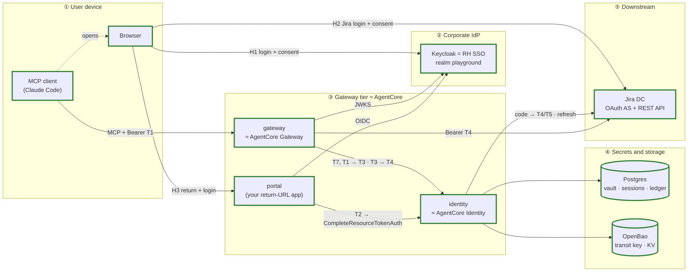
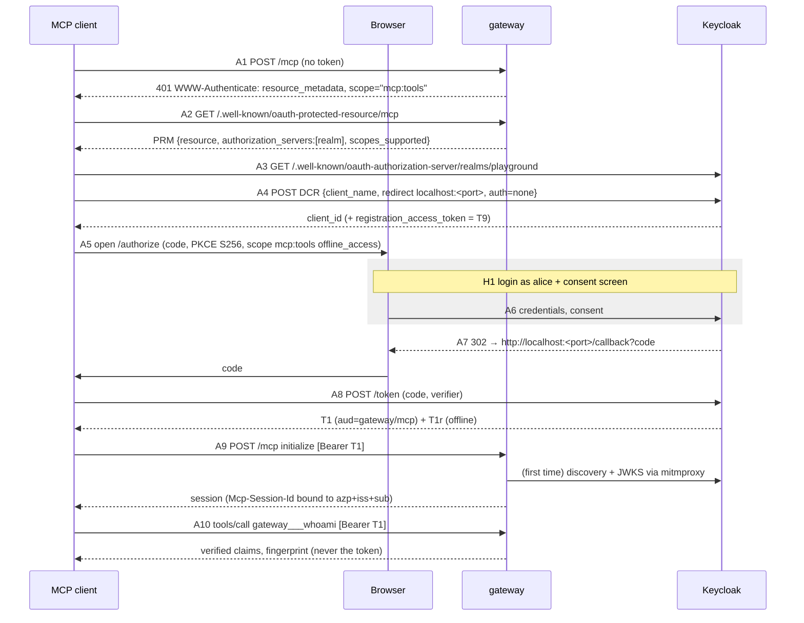
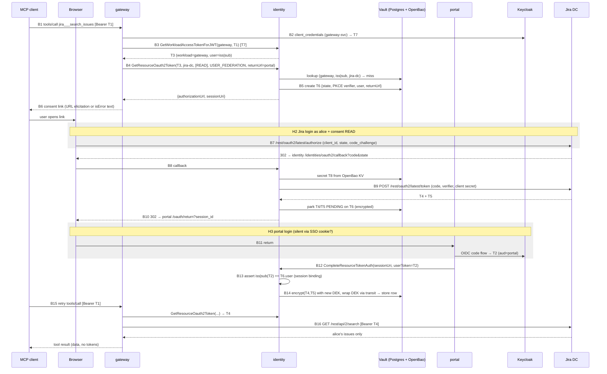
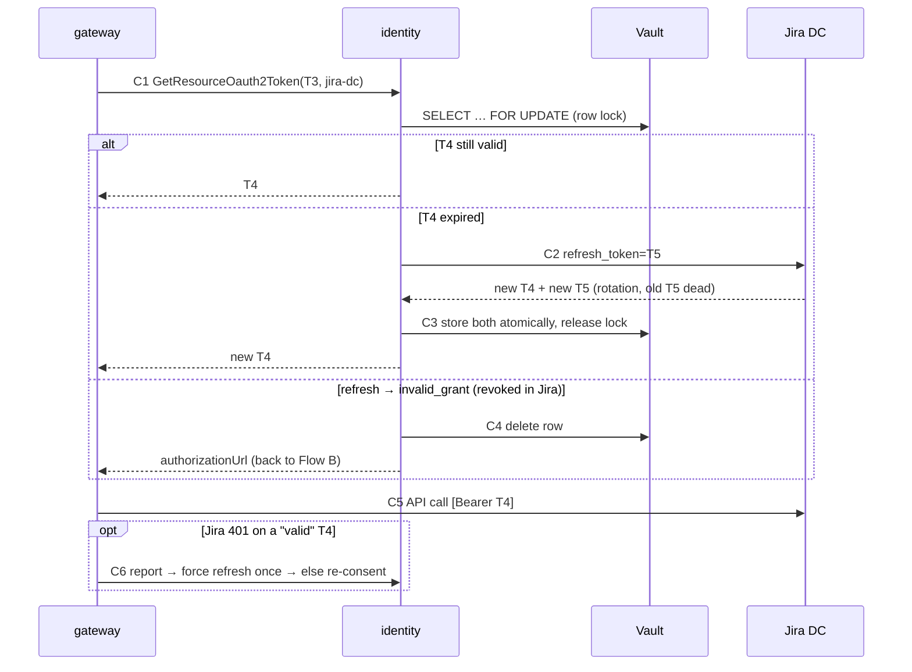
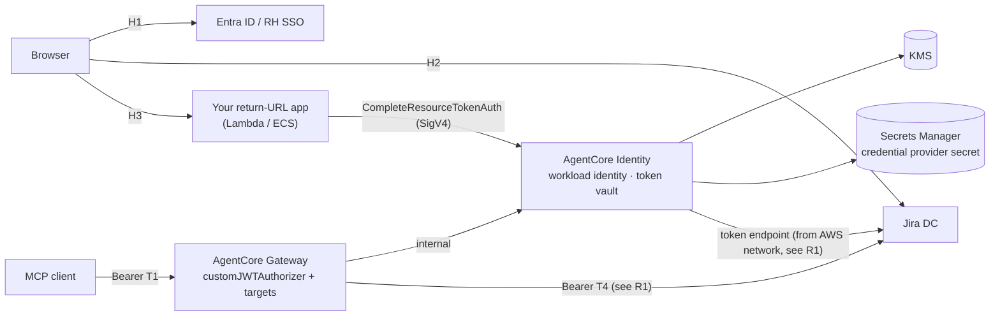

# Architecture: components, logins, consents and token flow

This is the architecture view of [SPEC.md](../SPEC.md). It covers what exists, who talks to whom, and every token's life from mint to death. Requirements, phases and risks stay in the spec. Status and evidence live in [PROGRESS.md](../PROGRESS.md).

**This document is kept true by evidence.** Every component, step and token carries a marker:

| Marker | Meaning |
|---|---|
| ✅ | **Verified**: observed in a real run. The evidence column says where (ledger event, check script, mitmweb flow, Keycloak state, S-scenario) |
| 🔷 | **Built**: code or infra exists, but this step hasn't been traced end to end |
| ⬜ | **Designed**: from the spec only, still unproven |

At the end of each phase, update the markers from that phase's traces (see `CLAUDE.md`). Anything observed that contradicts this document is a discovery: log it, then fix the document *and* the spec.

*Last verified: 2026-11-20 (phase 6: Confluence via the same path, `check6` 20/20. Phase 5: lifecycle and attacks through the gateway, `make check5` 22/22. Earlier: phase 4 end to end + S4 in Claude Code 2.1.328 on MCP 2026-07-28, `check4` 42/42; `check3` identity; `check2` stub)*

> **Stub caveat:** a ✅ on a Jira-side step means verified **against the stub**. Whether real Jira DC behaves the same is tracked separately in [stub-fidelity.md](stub-fidelity.md) (F1–F27, all unchecked).

---

## 1. Logical components and trust boundaries

*Border: solid green = ✅ verified · dashed blue = 🔷 built · dotted grey = ⬜ designed.*

| Zone | Component | Role | May hold | Must never hold | Status |
|---|---|---|---|---|---|
| ① | **MCP client** (Claude Code) | Discovers auth, registers itself, runs the user's OAuth login, calls tools | T1, T1r, its DCR registration (T9) | T4/T5, T3, any Jira credential | ✅ S2 |
| ① | **Browser** | Where every human login and consent happens (H1–H3) | IdP, Jira and portal session cookies | Tokens in URLs beyond one-time `code`/`state` | ✅ H1 (S2) |
| ② | **Keycloak** (RH SSO) | Authenticates the human. Issues T1 (to MCP clients), T2 (to portal), T7 (to gateway) | Users, password hashes, client registrations, sessions, consents, **realm signing keys** | Anything downstream | ✅ phase 0 + S2 |
| ③ | **gateway** | OAuth-protected MCP server. Validates T1, asks identity for downstream tokens, calls Jira | T1 / T3 / T4 **in memory, per request only**. JWKS cache | Persisted tokens of any kind. Raw tokens in logs | ✅ inbound (phase 1). ✅ downstream (`check4`: T7 → T3 → T4 → Jira per call) |
| ③ | **identity** | Workload identity + token vault + 3LO orchestration (AgentCore Identity's job) | T4/T5 (encrypted at rest), T6, Jira client secret (via OpenBao) | T1 beyond validating it. OpenBao root token | ✅ phase 3 (`check3`) |
| ③ | **portal** | Hosts the consent **return URL**. Proves who returned so the session can be bound. Shows "Connected apps" | A signed cookie with user id + name only. T2 for the length of one request | T4/T5. **Any stored token** | ✅ (`check4`) |
| ④ | **Postgres** | `identity` DB: vault ciphertext, OAuth sessions, ledger. `keycloak` DB | Ciphertext + wrapped data keys, fingerprints | Plaintext downstream tokens | ✅ (`check3`: row holds AES-GCM ciphertext + `vault:v1:` wrapped DEK, T4 not present in plaintext) |
| ④ | **OpenBao** | ≈ KMS (transit key `vault-dek`) + Secrets Manager (KV) | The key that unwraps every vault row (never exported). Client secrets | — | ✅ (`check3`: datakey/unwrap/encrypt via least-privilege `identity` policy token. Jira secret in KV) |
| ⑤ | **Jira DC** (stub) | Downstream authorization server *and* resource server | Its own grants per Jira user. Token **hashes** only (SQLite) | Plaintext tokens at rest | ✅ phase 2 (stub) |
| ⑤ | **Confluence DC** (stub persona) | A second downstream authorization server + resource server, with its **own app link** → its own consent (H2) and vault row | Its own grants per Confluence user. Token hashes only | Plaintext tokens at rest | ✅ phase 6 (`check6`) |

**Trust boundaries that matter**
- **①→③** Only T1 crosses. The gateway trusts nothing about the caller except a valid T1 (signature, `iss`, `aud`, `exp`). ✅
- **③→⑤** Only T4 crosses, and only from the gateway (API calls) or identity (token endpoint). T1 never crosses (no passthrough). ✅ for T1: Jira rejects a Keycloak T1 with 401 (`check2`, stub side of S15). ⬜ for T4 sent by the gateway (phase 4)
- **③ internal** Gateway → identity is service-authenticated (T7, ≈ IAM SigV4) *and* carries the user's T1, so identity knows both *which workload* and *which user*. ✅ (`check3`: no service token → 401. A user T1/T2 as caller → 401. portal-svc calling a gateway-only operation → 403)
- **①→③ via browser** The return to the portal is the only place where "the user who started consent" is proven to equal "the user who finished it". ✅ (`check4`: return → fresh OIDC login → `CompleteResourceTokenAuth` with that T2. `check3`: mismatch → 403)

---

## 2. Where humans act

There are exactly three moments where a person interacts, all in the browser. Everything else is machine-to-machine.

| # | Where | Triggered by | The user proves / grants | What it creates | Repeats when | Status |
|---|---|---|---|---|---|---|
| **H1** | Keycloak login + consent (`idp.localtest.me`) | MCP client `/mcp` → Authenticate | *I am alice* + *let "Claude Code (atlassian-playground)" use Atlassian tools through the gateway* (scope `mcp:tools`, plus `offline_access`) | T1 + T1r for (alice, that client). Keycloak stores the consent and an **offline session** | T1r dies (offline session revoked/expired, user disabled), client re-registers, consent revoked | ✅ S2 · **PKCE S256 enforced for every client** (phase 5, `check5`) |
| **H2** | Jira login + consent (`jira.localtest.me/rest/oauth2/latest/authorize`) | Gateway signals "connect Jira" (consent link) | *I am Jira user alice* + *let the gateway app READ Jira as me* | T4 + T5 for (gateway workload, alice, jira-dc). **This is the identity mapping** (SPEC §5) | T5 dies (revoked in Jira, expired, user removed), step-up to WRITE | ✅ Jira side (stub, `check2`: login, consent allow/deny, WRITE step-up, user without a Jira account fails). ⬜ triggered from a gateway consent link (phase 4) · ✅ **verified mapping (§5.2):** approving as the wrong Jira account → rejected at binding (`check5` S10). `downstream_user` recorded | · ✅ **per product:** Confluence needs its own H2. A Jira grant doesn't cover it. Verify mode applies to both (`check6`) |
| **H3** | Portal return (`portal.localtest.me/oauth/return`) | Redirect from identity after H2 | *The person finishing this consent is still alice* (OIDC login, usually silent through the H1 SSO cookie) | T2, then a `CompleteResourceTokenAuth` call that commits T4/T5 to the vault | Every H2 | ✅ real portal (`check4`): the user saw only `login@jira` + `consent@jira`, and **the portal's Keycloak login was silent**. ⬜ with Claude Code (`offline_access` login, real browser): S4 |

H1 is about the **MCP client**: the user trusts a program to act for them at the gateway. H2 is about the **gateway**: the user trusts it to act for them at Jira. They are separate grants, revoked separately, and neither implies the other.

---

## 3. End-to-end token flow

Step ids (A1, B7, …) are stable. The tables below the diagrams give each step's status and evidence.

### 3.1 Flow A: connect and log in (H1)

| Step | What happens | Generates | Stored by | Status | Evidence |
|---|---|---|---|---|---|
| A1 | Unauthenticated request is challenged | — | — | ✅ | `check1` S1. S2: 17× `POST /mcp 401` in gateway log |
| A2 | Client reads Protected Resource Metadata (RFC 9728) | — | — | ✅ | `check1`. S2: 8× path-suffixed + 1× root PRM GET |
| A3 | Client reads AS metadata via RFC 8414 path insertion | — | — | ✅ scripted / 🔷 Claude Code | `check1` (Keycloak serves it natively). Claude Code's own request isn't logged (client traffic not proxied) |
| A4 | Dynamic Client Registration | client_id, T9 | Keycloak DB (client), client store | ✅ | Keycloak: client "Claude Code (atlassian-playground)", public, `consentRequired`, optional scopes `mcp:tools`, `offline_access` |
| A5–A6 | **H1**: browser login + consent | Keycloak SSO cookie, consent record | Browser, Keycloak DB | ✅ | S2 (alice logged in and consented) |
| A7–A8 | Code → token exchange (public client + PKCE) | **T1**, **T1r** | MCP client store. Keycloak DB (offline session) | ✅ | Ledger 14:20:54 `inbound.validated` azp `b8bb83e8…`. Keycloak shows alice's **offline** session for that client. PKCE use by Claude Code is unconfirmed, and Keycloak doesn't require it for DCR clients |
| A9 | Gateway validates T1: signature (JWKS), iss, aud, exp, client | MCP session id | Gateway memory | ✅ | Ledger `inbound.validated`. mitmweb: one discovery + one JWKS fetch, then cached |
| A10 | Tool call with identity only | — | — | ✅ | Ledger 14:21:16 `tool.call gateway___whoami`. `check1`: fingerprint matches, raw token never echoed |

### 3.2 Flow B: first Jira call, consent (H2 + H3)

| Step | What happens | Generates | Stored by | Status |
|---|---|---|---|---|
| B1 | Tool call needing downstream access | — | — | ✅ `tool.call` T1 (`check4`) |
| B2 | Gateway authenticates itself (≈ IAM role) | **T7** | Gateway memory | ✅ real gateway: `service_token.minted` T7, cached (`check4`). mitmweb shows `→ T7` on gateway → identity |
| B3 | Bind workload + user | **T3** | Gateway memory (one call) | ✅ `wat.minted` T3 `{wl: gateway, sub: iss\|sub}`, 300 s (`check3`) |
| B4–B5 | Vault miss → start 3LO | **T6** | Postgres `oauth_sessions` (verifier encrypted) | ✅ `vault.miss` → `session.created`. authorizationUrl has the identity callback + S256. Verifier stored `vault:v1:…` (`check3`) |
| B6 | Consent link to the user through the MCP client | — | — | ✅ both signals (`check4`): client without `elicitation.url` → `isError` tool result with the link. Client with it → JSON-RPC **-32042** `{mode: url, url, elicitationId}`, and the link is **also in the error message**, so it survives a declined prompt. ✅ **Claude Code 2.1.328 declares `elicitation.url`** and gets -32042 (ledger `consent.signalled mode=url_elicitation`, S4). ⚠️ **Declined prompt → Claude Code doesn't show the error message, so the link is lost** (S4 run 2). ✅ Claude Code end to end via **portal pre-consent** (S4 run 2). ✅ via the **prompt's URL** (S4 run 3: 10:26:01 signal → 10:26:09 `binding.ok`, same session). **Protocol matters:** Claude Code negotiates **2026-07-28**, where B6 = the tool returns `InputRequiredResult` (URL elicitation), and B15 = the **client retries** the same call ("Retry now"). ✅ in `check4` (accept and decline), ✅ Claude Code "Retry now" → results (S4 run 4). For 2025-11-25 clients: -32042 + `notifications/elicitation/complete` ✅ (`check4`). ✅ **Claude Code end to end on 2026-07-28** (S4 run 5: `input_required` 10:49:31 → `binding.ok` 10:49:37 → user clicks "I'm done, continue" → retry → `vault.hit` → Jira 200 at 10:50:51) |
| B7 | **H2**: Jira login + consent | Jira grant, Jira session cookie | Jira (SQLite), browser | ✅ stub (`check2`: `oauth.consent_shown` → `oauth.code_issued`, `pkce=true`). Real DC: F2, F4, F25 |
| B8–B9 | Code exchange at the Jira token endpoint, using the client secret | **T4**, **T5** | Postgres, encrypted, *pending* | ✅ Jira side (`check2`). ✅ identity side (`check3`: `callback.tokens_parked` T4/T5, session `PENDING_BINDING`, parked tokens unusable, callback replay → 400) |
| B10–B11 | **H3**: return + portal login | **T2** | **Nowhere**: request-scoped | ✅ `consent.returned` → `user.login` T2 (silent SSO) (`check4`) |
| B12–B13 | Session binding (anti consent-hijack, S9) | — | — | ✅ (`check3`: bob completing alice's session → 403 `binding.mismatch`, session FAILED, parked tokens wiped, nothing stored. Then alice's own session → `binding.ok`). ✅ called by the real portal: `binding.requested` → `binding.ok` (`check4`) |
| B14 | Commit to vault: envelope encryption | DEK (per row), wrapped DEK | Postgres `token_vault`. Key stays in OpenBao | ✅ `vault.store`. AAD binds ciphertext to its row: ciphertext swapped between rows → tag failure → `vault.corrupt_purged` (`check3`) |
| B15–B16 | Retry → vault hit → call Jira as alice | — | — | ✅ `resource_token.received` T4 → `downstream.call` T4 → Jira `api.call` with the **same fp**. alice sees ALPHA only, bob BETA only (`check4`: S3, S5, S8) |

### 3.3 Flow C: later calls, refresh and failure

**Jira side ✅ against the stub** (`check2`): C2 rotation (new T4 + T5, old T5 → `invalid_grant`, old T4 valid until expiry), C4 `invalid_grant` after the user revokes or with the `force_invalid_grant` fault, C5/C6 401 for expired or revoked T4. **identity side ✅** (`check3`): C1 `vault.hit`. C2–C3 refresh under the row lock: **10 concurrent requests on a stale T4 → exactly 1 refresh at Jira, 1 `vault.refreshed` + 9 `vault.hit`, all get the same T4**. C4 grant revoked → refresh `invalid_grant` → `vault.purged` → new authorizationUrl. **gateway side ✅** (`check4`): C5 `downstream.call` T4. **C6:** revoked in Jira → Jira 401 → gateway `x-ResourceTokenRejected` → identity tries one refresh under the row lock → `invalid_grant` → **row purged** (`downstream.unauthorized vault=PURGED`) → consent link. The portal then shows "Not connected", and the next call is `vault.miss` → consent with no Jira call (`check4`). *Before the fix, the dead T4 stayed in the vault and every call looped 401 → new link: seen in the S4 run, 16:52–16:55.* Concurrency through the gateway (S7) ⬜ phase 5.

---

## 4. Token and secret lifecycle

| Id | What | Minted by (step) | Audience / bound to | Held by (in use) | At rest | Lifetime | Renewed by | Dies when | Must never reach | Status |
|---|---|---|---|---|---|---|---|---|---|---|
| **T1** | Gateway access token (JWT) | Keycloak (A8) | `aud`=gateway/mcp **+ `gateway-svc`** (for introspection), `azp`=DCR client, `sub`=user, scope `mcp:tools …` | MCP client, then gateway per request | MCP client credential store | 5 min | T1r (client-side) | `exp`. Signature key rotated | Jira, tool results, logs | ✅ · after the user is disabled: still valid until `exp` unless the gateway introspects (`check5` S17) |
| **T1r** | Refresh token, **offline** for Claude Code | Keycloak (A8) | Client + user + offline session | MCP client | Client store. Keycloak DB (offline session) | Offline session idle (Keycloak default, not yet configured or verified) | Refresh rotation | Offline session revoked, user disabled, consent revoked | Gateway | ✅ minted · ⬜ lifetime · ✅ dies at once when the user is disabled (`check5` S17). Claude Code uses it on nearly every connection burst, often twice in parallel (R7) |
| **T2** | Portal token | Keycloak (B11) | `aud`=portal (Keycloak refuses `mcp:tools` to portal ✅) | portal, one request | **None** (request-scoped) | 5 min | Not needed (fresh login per return) | End of request / `exp` | Gateway (rejected ✅ S14) | ✅ (`check4`: minted silently on return, used for binding, never stored) |
| **T3** | Workload access token | identity (B3) | workload `gateway` + user `iss\|sub` | gateway | none | 5 min | Re-minted per call | `exp` | Client, Jira | ✅ (`check3`) |
| **T4** | Jira access token (opaque) | Jira (B9, C2) | Jira user + scopes (READ/WRITE) | identity → gateway for one call | Vault, envelope-encrypted | DC ≈ 2 h (stub 60 s in tests) | T5 | `exp`, revoke in Jira, rotation | Client, LLM, logs, Postgres in plaintext | ✅ stub (`check2`) · ✅ vault (`check3`) · ✅ identity → gateway → Jira for one call, never logged (`check4`) |
| **T5** | Jira refresh token (rotating) | Jira (B9, C2) | Same | identity only | Vault, envelope-encrypted | DC ≈ 90 d | Rotates on every use | Used once, revoked, expired | Everything outside identity | ✅ minted + rotation at the stub (`check2`). ⬜ vault |
| **T6** | 3LO session (state, PKCE verifier, session_uri) | identity (B5) | (workload, user, provider, return URL) | identity | Postgres (verifier encrypted) | 10 min, single use | — | Completed, expired, failed | — | ✅ IN_PROGRESS → PENDING_BINDING → COMPLETED/FAILED (`check3`) |
| **T7** | Gateway service token | Keycloak client-credentials (B2) | `aud`=identity | gateway | none (secret in `.env`, later OpenBao) | 5 min | Re-mint | `exp` | — | ✅ gateway-svc + portal-svc tokens (`check3`) |
| **T8** | Jira OAuth client_id/secret | Jira admin (incoming app link) | the gateway "app" in Jira | identity (token-endpoint calls only) | OpenBao KV (today: `.env` → stub seed) | Static | Manual rotation | Rotated in Jira | Everything else | ✅ in OpenBao KV `secret/credential-providers/jira-dc`, read per token-endpoint call (`check3`) |
| **T9** | DCR registration access token | Keycloak (A4) | That DCR client | MCP client | Client store | Until used/rotated | — | Client deleted | — | ✅ (scripted delete in checks) |

**Other secrets and keys**

| What | Where | Protects | Status |
|---|---|---|---|
| Realm signing keys (RSA) | Keycloak DB | Every T1/T2/T7. The gateway trusts them through JWKS | ✅ in use |
| `vault-dek` transit key | OpenBao (Raft), never exported | Wraps every vault row's data key (≈ KMS CMK) | ✅ in use (`check3`) |
| OpenBao unseal key + root token | `.secrets/openbao-init.json` (host, gitignored) | All of OpenBao. Local-only concern (KMS needs no unseal) | ✅ |
| Client secrets (`portal`, `gateway-svc`), DB passwords | `.env` (host, gitignored) → container env | Service identities | ✅ |
| Keycloak SSO / Jira / portal session cookies | Browser | Silent re-login (H3 relies on Keycloak's. Jira's `JSESSIONID` skips the Jira login on later consents) | ✅ Keycloak · ✅ Jira (stub) · ⬜ portal |
| Jira Personal Access Tokens (contrast only) | Stub SQLite (hash) | The user's **full** rights, no app, no scope | ✅ stub (`check2`) |

---

## 5. Storage map: what each store holds and what a breach exposes

| Store | Holds | If an attacker reads only this… | Status |
|---|---|---|---|
| MCP client store (device) | T1, T1r (offline), client_id, T9 | They can act as the user **at the gateway** until the offline session is revoked. No direct Jira access | ✅ (S2) · disabling the user in the IdP kills T1r at once. T1 lives ≤ 5 min (or 0 with gateway introspection) |
| Keycloak DB | Users, password hashes, clients, consents, sessions incl. offline, **signing keys** | They can forge any IdP token: game over for the inbound side | ✅ |
| `identity` Postgres | Vault ciphertext + wrapped DEKs, T6 sessions, ledger fingerprints | **Nothing usable.** Every row needs OpenBao transit to unwrap | ✅ (`check3`: ciphertext + wrapped DEK only. Admin view shows metadata only) · ⚠️ a **disabled** user's rows stay (no IdP lifecycle hook): S17 |
| OpenBao | Transit key (no export), KV secrets (T8) | T8 lets them impersonate the *app* at Jira's token endpoint, but they have no user grants. With transit access **plus** the DB, they get every user's Jira tokens | ✅ identity's token can't do anything else (policy `identity`) |
| Gateway memory | JWKS cache. T1/T3/T4 for in-flight requests | In-flight tokens only | ✅ (nothing persisted) |
| Ledger (Postgres + stdout) | Fingerprints + non-secret claims | Who did what, when. No credentials | ✅ stdout · ✅ `ledger` DB via insert-only `ledger_writer`, read by the portal (`check4`: events from all 4 services, no raw T1 in the DB) |

---

## 6. Invariants: where each one is enforced

| # (SPEC §3) | Invariant | Enforced at | Status / evidence |
|---|---|---|---|
| 1 | T4/T5 never leave identity, except T4 → gateway for one call | identity API surface. Gateway doesn't persist | ✅ (`check4`: T4 goes identity → gateway (`resource_token.received`) → Jira only. Tool results carry data, never tokens) |
| 2 | No passthrough: T1 never reaches Jira | Gateway uses only T4 downstream. Jira rejects T1 | ✅ S15 (`check4`: no T1 fingerprint in any Jira `api.*` event. Every gateway `downstream.call` fp = a Jira `api.call` fp. mitmweb labels every proxied Jira API call `→ T4`) |
| 3 | Vault key `user_id` only from verified T1 `iss\|sub` | identity `GetWorkloadAccessTokenForJWT` | ✅ identity derives `iss\|sub` only from a verified userToken. The vault key = T3 `sub` (`check3`). Gateway shows the same value ✅ (`whoami.user_id`) |
| 4 | Consent session completed only by its initiator | `CompleteResourceTokenAuth` (B13) | ✅ S9 (`check3`) |
| 5 | Gateway rejects wrong `aud` | Gateway JWT authorizer | ✅ `check1` S14 (5 rejection cases with ledger reasons) |
| 6 | Only fingerprints in logs and ledger | `playground_common.ledger` | ✅ gateway (`check1`) · ✅ Jira stub (`check2`, 16 tokens) · ✅ identity (`check3`, 19 tokens: T1 T2 T3 T4 T7) · ✅ all 4 service logs + ledger DB (`check4`). **Access logs were leaking one-time `code`/`state` from callback URLs, so they're now off for identity and portal** |
| — | A disabled user can't keep using the gateway | Keycloak (T1r) + optional gateway introspection (T1) | ✅ T1r revoked at once. ✅ T1 refused with introspection on. ⚠️ without introspection T1 works until `exp` (`check5` S17) |
| — | The Jira account that consented is the one this user should have | identity at binding (§5.2 verify mode) | ✅ `check5` S10 |
| — | MCP session usable only by the principal that created it | MCP SDK session manager | ✅ `check1`: bob on alice's session → 404 |

---

## 7. Mapping to AWS

| Local | AWS | What changes for you |
|---|---|---|
| Keycloak | Entra ID / RH SSO | Discovery URL in the authorizer config. Entra has no DCR (`mcp-public`-style pre-registration), `aud` format differs (R5) |
| gateway | AgentCore Gateway | You configure it rather than write it. Steps A1–A2 and A9 are handled by AWS (check PRM support, R3) |
| identity | AgentCore Identity | You configure it rather than write it. B3–B5, B8–B9, B14 and Flow C are internal. Callback URL becomes `https://bedrock-agentcore.<region>.amazonaws.com/identities/oauth2/callback` (R4) |
| T7 (Keycloak client creds) | IAM role + SigV4 | Gateway ↔ Identity is internal. Portal → Identity uses the portal's IAM role |
| OpenBao transit / KV | KMS / Secrets Manager | Managed. No unseal |
| portal | **Still yours** | You host the return URL and call `CompleteResourceTokenAuth` (B11–B13) |
| Network: everything on one Docker network | Jira DC must be reachable **from AWS-managed infrastructure** for B9/C2 (token endpoint) and B16 (API) | The biggest open risk (R1) |

---

## 8. Open questions raised by this document

| Question | Resolve in | Why it matters |
|---|---|---|
| Is H3 (portal login) silent after an MCP-client login, given Keycloak shows only an *offline* session for that client? | Phase 4 | If not silent, the user logs in twice during consent. **Answered for the scripted flow:** silent through the real portal (`check4`). Claude Code + real browser still to confirm (S4) |
| What does Claude Code do with a URL-mode elicitation vs an `isError` consent link? | Phase 4 (S4) | That decides B6's design. The gateway now does both (`check4`), so S4 only needs to observe which one Claude Code triggers |
| Why did one Claude Code login plus one tool call present 4 different T1 fingerprints in about 22 s? | **Answered (phase 5):** Claude Code refreshes on almost every connection burst, often twice in parallel | Ledger noise is harmless. Parallel refreshes + IdP reuse detection is a risk (SPEC R7) |
| Offline-session lifetime and revocation policy for MCP clients | Phase 5 | Determines how long a stolen device token works (§5 row 1) **Partly answered:** disabling the user revokes it at once (`check5`). The policy decision is still open |
| Does Claude Code send PKCE and `resource`? | Next interactive Claude Code login | **PKCE is now enforced realm-wide** (`check5`), so a successful re-login proves Claude Code sends it. `resource` is still unobserved (Keycloak ignores it) |
